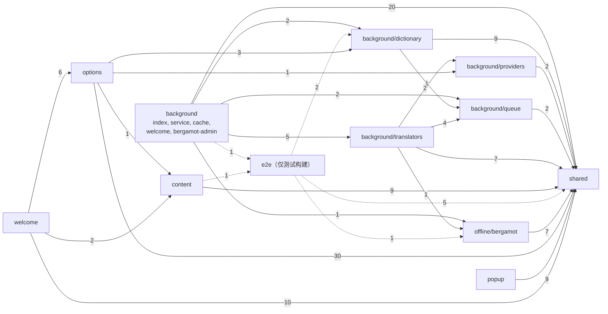
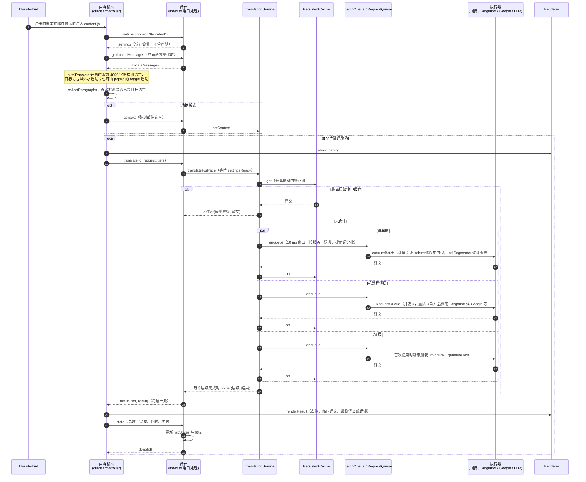

# Thunderbird Translate 体积与结构分析

对象是 v1.5.2（提交 `4455516`，测量开始时工作区无未提交改动）的构建产物 `dist/` 与 `web-ext-artifacts/thunderbird-translate-1.5.2.xpi`，以及 `src/`、`tests/`、`e2e/`、`tools/dict-build/`、`scripts/` 的源码。所有数字于 2026-10-11 用脚本实测，运行环境为 Windows 11、Node 24.21.0、esbuild 0.28.2。运行时下载数据（词典索引、Mozilla Remote Settings）同日在线读取。

本文的约定如下。

- 原始大小指未压缩字节，压缩大小指 xpi 内 deflate 压缩后的字节，两者都取自 zip 中央目录。
- KiB、MiB 以 1024 为进位。README 中的 MB 以 10^6 字节计，换算关系在涉及处注明。
- 优化建议里的"实验"都在临时目录用 esbuild 重新打包后测得，没有改动仓库的任何文件。

# 概览

xpi 共 1,900,526 字节（1.81 MiB），含 32 个文件，解压后 3,811,046 字节。其中 Bergamot 引擎的 wasm 文件（压缩格式为 zstd，下称 wasm.zst）占压缩体积的 63.4%，Vercel AI SDK（下称 AI SDK）的懒加载 chunk 占 20.5%，两项合计 83.9%。余下的 16.1% 由 12 种界面语言的消息文件、页面脚本、后台入口、内容脚本、CSS 和 HTML 分担。

| 项目 | 数值 | 测量方法 |
| :--- | ---: | :--- |
| xpi 文件大小 | 1,900,526 B（1.81 MiB） | 文件系统字节数；与用 fflate level 9 重新打包 `dist/` 的结果逐字节相同 |
| xpi 内文件数 / 解压总量 | 32 / 3,811,046 B | zip 中央目录 |
| wasm.zst（压缩 / 解压） | 1,203,124 B / 4,960,506 B | zip 中央目录；fzstd 解压后计数 |
| AI SDK chunk（原始 / 压缩） | 1,573,662 B / 389,137 B | zip 中央目录 |
| 后台启动路径（background.js 加共享 chunk，原始 / 压缩） | 103,590 B / 38,928 B | 同上；AI SDK chunk 在首次 AI 请求时才加载 |
| 内容脚本 content.js（原始） | 54,980 B | 每次显示邮件都会注入 |
| 词典包（22 个，下载 / 解压） | 33,478,857 B（31.9 MiB）/ 186,961,697 B（178.3 MiB） | `dict-index.json` 汇总 |
| Bergamot 可用方向 | 114 个，涉及 58 种语言 | `selectPairs()` 对 404 条记录的筛选结果 |
| Bergamot 每方向下载（最小 / 中位 / 最大） | 12.9 / 22.9 / 46.0 MiB | 同上 |
| Bergamot 两个方向同时加载的 wasm 堆 | 395 MiB | 引用 `docs/bergamot.md` 的既有实测 |
| `src/` 代码行 | 69 个文件，6,985 行 | cloc 2.06，不含空行与注释行 |
| `tests/` 代码行 | 37 个文件，8,242 行；1,018 个用例通过（32 个测试文件） | cloc；`npx vitest run` |
| 循环依赖 | 0 | `madge --circular --extensions ts src`，70 个文件（含 `locales/en.json`） |

# 扩展包构成

## 测量方法

用脚本读取 xpi 的 zip 中央目录，取每个条目的原始大小和压缩大小，再按文件名归入类别。类别规则固定如下：`chunks/llm-*.js` 为 AI SDK chunk，`chunks/` 下的其他文件为共享 chunk，`_locales/` 为 locale，`bergamot-translator.js` 为胶水 JS，`.css` 与 `.html` 合为一类。xpi 文件大小比条目压缩大小之和多 3,622 字节，这部分是 zip 的本地头与中央目录，下表的占比以条目压缩大小之和 1,896,904 字节为分母。

## 按类别汇总

| 类别 | 文件数 | 原始字节 | 占原始 | 压缩字节 | 占压缩 | 压缩率 |
| :--- | ---: | ---: | ---: | ---: | ---: | ---: |
| Bergamot 引擎 wasm.zst | 1 | 1,211,955 | 31.8% | 1,203,124 | 63.4% | 99% |
| AI SDK chunk（chunks/llm-*.js） | 1 | 1,573,662 | 41.3% | 389,137 | 20.5% | 25% |
| locale（_locales，12 种语言） | 12 | 445,610 | 11.7% | 111,538 | 5.9% | 25% |
| popup、options、welcome 脚本 | 3 | 241,827 | 6.3% | 84,778 | 4.5% | 35% |
| Bergamot 胶水 JS | 1 | 100,187 | 2.6% | 22,823 | 1.2% | 23% |
| 后台入口（background.js） | 1 | 55,538 | 1.5% | 21,519 | 1.1% | 39% |
| 内容脚本（content.js） | 1 | 54,980 | 1.4% | 19,883 | 1.0% | 36% |
| 共享 chunk（后台启动时加载） | 1 | 48,052 | 1.3% | 17,409 | 0.9% | 36% |
| manifest.json 与 LICENSE | 2 | 37,039 | 1.0% | 13,087 | 0.7% | 35% |
| CSS 与 HTML | 7 | 31,721 | 0.8% | 8,556 | 0.5% | 27% |
| Bergamot worker | 1 | 9,917 | 0.3% | 4,789 | 0.3% | 48% |
| 图标 | 1 | 558 | 0.0% | 261 | 0.0% | 47% |
| 合计 | 32 | 3,811,046 | 100% | 1,896,904 | 100% | 50% |

wasm.zst 的压缩率为 99%，说明它在进入 xpi 之前已经是压缩数据，zip 的 deflate 只多压掉 8,831 字节。AI SDK chunk 是普通 minify 后的 JavaScript，压缩率 25%，所以它在原始大小里占 41.3%，在压缩大小里只占 20.5%。

## 按文件列出

| 文件 | 类别 | 原始字节 | 压缩字节 | 占压缩合计 | 压缩率 |
| :--- | :--- | ---: | ---: | ---: | ---: |
| `bergamot-translator.wasm.zst` | Bergamot 引擎 wasm.zst | 1,211,955 | 1,203,124 | 63.4% | 99% |
| `chunks/llm-3KOFQTIB.js` | AI SDK chunk | 1,573,662 | 389,137 | 20.5% | 25% |
| `welcome.js` | popup、options、welcome 脚本 | 106,912 | 37,939 | 2.0% | 35% |
| `options.js` | popup、options、welcome 脚本 | 89,190 | 30,978 | 1.6% | 35% |
| `bergamot-translator.js` | Bergamot 胶水 JS | 100,187 | 22,823 | 1.2% | 23% |
| `background.js` | 后台入口 | 55,538 | 21,519 | 1.1% | 39% |
| `content.js` | 内容脚本 | 54,980 | 19,883 | 1.0% | 36% |
| `chunks/chunk-ORTEPFXI.js` | 共享 chunk | 48,052 | 17,409 | 0.9% | 36% |
| `popup.js` | popup、options、welcome 脚本 | 45,725 | 15,861 | 0.8% | 35% |
| `LICENSE` | manifest.json 与 LICENSE | 35,823 | 12,559 | 0.7% | 35% |
| `_locales/ru/messages.json` | locale | 47,165 | 10,715 | 0.6% | 23% |
| `_locales/ja/messages.json` | locale | 40,350 | 9,847 | 0.5% | 24% |
| `_locales/de/messages.json` | locale | 37,008 | 9,469 | 0.5% | 26% |
| `_locales/ko/messages.json` | locale | 37,241 | 9,406 | 0.5% | 25% |
| `_locales/fr/messages.json` | locale | 37,591 | 9,402 | 0.5% | 25% |
| `_locales/vi/messages.json` | locale | 38,650 | 9,179 | 0.5% | 24% |
| `_locales/tr/messages.json` | locale | 35,534 | 9,132 | 0.5% | 26% |
| `_locales/es/messages.json` | locale | 36,443 | 9,121 | 0.5% | 25% |
| `_locales/pt_BR/messages.json` | locale | 35,973 | 9,097 | 0.5% | 25% |
| `_locales/zh_TW/messages.json` | locale | 32,801 | 8,915 | 0.5% | 27% |
| `_locales/zh_CN/messages.json` | locale | 32,599 | 8,875 | 0.5% | 27% |
| `_locales/en/messages.json` | locale | 34,255 | 8,380 | 0.4% | 24% |
| `bergamot-worker.js` | Bergamot worker | 9,917 | 4,789 | 0.3% | 48% |
| `options.css` | CSS 与 HTML | 6,240 | 1,724 | 0.1% | 28% |
| `welcome.html` | CSS 与 HTML | 8,051 | 1,693 | 0.1% | 21% |
| `options.html` | CSS 与 HTML | 6,872 | 1,497 | 0.1% | 22% |
| `welcome.css` | CSS 与 HTML | 2,965 | 1,048 | 0.1% | 35% |
| `popup.css` | CSS 与 HTML | 2,848 | 984 | 0.1% | 35% |
| `content.css` | CSS 与 HTML | 2,226 | 839 | 0.0% | 38% |
| `popup.html` | CSS 与 HTML | 2,519 | 771 | 0.0% | 31% |
| `manifest.json` | manifest.json 与 LICENSE | 1,216 | 528 | 0.0% | 43% |
| `icons/icon.svg` | 图标 | 558 | 261 | 0.0% | 47% |

## 观察

wasm.zst 已经接近 zstd 的压缩极限。用 Node 的 zstd 对解压后的 wasm 重新压缩，level 3 得 1,568,629 字节，level 12 得 1,414,340 字节，level 19 得 1,213,421 字节，level 22 得 1,214,121 字节，而 xpi 里的文件是 1,211,955 字节。重新压缩没有收益。反过来，如果 xpi 存放未经 zstd 的 wasm，deflate level 9 的结果是 1,880,376 字节，比现在多 677,252 字节，所以保留 zstd 加运行时用 fzstd 解压的做法节省了 36% 的体积。fzstd 解压这个文件在本机耗时约 19 ms（单次计时）。

12 个 `_locales/*/messages.json` 合计原始 445,610 字节，压缩 111,538 字节，占 5.9%。把这些 JSON 去掉缩进后原始大小降到 370,946 字节（减少 16.8%），xpi 只缩小 2,515 字节，因为 deflate 本来就吃掉了缩进。这一项没有优化价值。

后台启动时 Thunderbird 加载 `background.js`（55,538 B）和共享 chunk（48,052 B），共 103,590 字节。AI SDK chunk 由 `import("./translators/llm")` 在首次 AI 请求时加载（`src/background/service.ts`），在设置里启用 AI 层时 `src/background/index.ts` 也会提前加载。CHANGELOG 记载 1.5.2 把启动脚本从 1640 KiB 降到 54 KiB（另加 47 KiB 共享 chunk）。

# bundle 依赖构成

## 测量方法

`scripts/build.mjs` 已经开启 `metafile: true`，但只用它做守卫检查。本次在临时脚本中用与构建脚本完全相同的 esbuild 选项重新打包（输出到临时目录，`write: false`），得到的 6 个入口 JS 输出（background、content、popup、options、welcome、bergamot-worker）与 `dist/` 中对应文件用 `cmp` 比较，逐字节相同。统计量取 metafile 里 `outputs[*].inputs[*].bytesInOutput`，即该输入文件在 minify 之后写入输出文件的字节数。归类规则：路径中最后一段 `node_modules/` 之后的包名（含 `@scope/name`）归为 npm 包，`src/` 下的文件按目录归类，`locales/en.json` 单列。各组之和与输出文件大小的差在 25 到 911 字节之间，是 esbuild 生成的模块包装代码。

## 后台入口、共享 chunk 与页面脚本

| 贡献者（minify 后字节） | background.js | 共享 chunk | content.js | popup.js | options.js | welcome.js | bergamot-worker.js |
| :--- | ---: | ---: | ---: | ---: | ---: | ---: | ---: |
| src/shared | 11,559 | 21,016 | 20,420 | 22,356 | 38,951 | 41,523 | 0 |
| locales/en.json（英文消息表） | 0 | 20,995 | 20,996 | 20,996 | 20,996 | 20,996 | 0 |
| src/background（直属文件） | 12,096 | 0 | 0 | 0 | 0 | 0 | 0 |
| src/background/translators | 4,288 | 5,130 | 0 | 0 | 0 | 0 | 0 |
| src/background/dictionary | 3,393 | 0 | 0 | 0 | 2,537 | 2,545 | 0 |
| src/background/providers | 0 | 0 | 0 | 0 | 3,139 | 3,139 | 0 |
| src/background/queue | 3,032 | 0 | 0 | 0 | 721 | 721 | 0 |
| src/offline/bergamot | 13,828 | 0 | 0 | 0 | 0 | 0 | 2,876 |
| src/content | 0 | 0 | 13,539 | 0 | 590 | 13,624 | 0 |
| src/options | 0 | 0 | 0 | 0 | 22,231 | 17,438 | 0 |
| src/popup | 0 | 0 | 0 | 2,348 | 0 | 0 | 0 |
| src/welcome | 0 | 0 | 0 | 0 | 0 | 6,901 | 0 |
| npm: fzstd | 7,096 | 0 | 0 | 0 | 0 | 0 | 7,016 |
| bundle 总字节 | 55,538 | 48,052 | 54,980 | 45,725 | 89,190 | 106,912 | 9,917 |
| xpi 内压缩字节 | 21,519 | 17,409 | 19,883 | 15,861 | 30,978 | 37,939 | 4,789 |

有三点可以从这张表直接读出。

- `locales/en.json` 在 5 个输出里各有一份，每份 20,995 到 20,996 字节。它由 `src/shared/i18n.ts` 导入，作为英文消息表内置。后台是 ESM 构建，这份数据在共享 chunk 里；content、popup、options、welcome 是 iife 构建，各自带一份。
- `welcome.js` 比 `options.js` 大 17,722 字节。欢迎页复用了设置页的面板（`src/options` 17,438 字节），还内置了一个内容脚本客户端和渲染器用于示例邮件（`src/content` 13,624 字节）。
- `options.js` 与 `welcome.js` 都包含 `src/background/providers`、`src/background/dictionary`、`src/background/queue` 的代码，页面脚本直接导入了后台目录里的模块。

## 同一模块在多个输出中的重复

把每个输入文件在所有输出里的 `bytesInOutput` 相加，再减去其中最大的一份，得到重复部分。共有 39 个输入文件进入了不止一个输出，合计 358,857 字节，重复部分为 247,825 字节。前 10 位占重复部分的 79.4%：

| 输入文件 | 出现次数 | 各份合计字节 | 重复部分字节 |
| :--- | ---: | ---: | ---: |
| `locales/en.json` | 5 | 104,979 | 83,983 |
| `src/shared/providers.ts` | 5 | 49,208 | 39,068 |
| `src/shared/errors.ts` | 5 | 27,872 | 20,837 |
| `src/shared/settings.ts` | 4 | 18,575 | 13,309 |
| `node_modules/fzstd` | 2 | 14,112 | 7,016 |
| `src/shared/prompt-presets.ts` | 2 | 13,908 | 6,954 |
| `src/shared/prompts.ts` | 4 | 9,266 | 6,935 |
| `src/shared/languages.ts` | 5 | 8,913 | 6,715 |
| `src/background/providers/thinking.ts` | 3 | 9,651 | 6,278 |
| `src/shared/i18n.ts` | 5 | 7,284 | 5,717 |

fzstd 的两份分别在 `background.js`（7,096 字节）和 `bergamot-worker.js`（7,016 字节），因为后台用它校验模型文件，worker 用它解压 wasm 和模型。

## AI SDK chunk 的组成

chunk 原始 1,573,662 字节，共 127 个输入文件。下表列出前 15 位的包，字节数是各包在所有输出里的 `bytesInOutput` 之和；这 15 个包全部只出现在 AI SDK chunk 里。

| 排名 | 包 | 输出中的字节 | 占 llm chunk |
| ---: | :--- | ---: | ---: |
| 1 | `zod` | 384,285 | 24.4% |
| 2 | `@ai-sdk/openai` | 332,972 | 21.2% |
| 3 | `@ai-sdk/google` | 147,861 | 9.4% |
| 4 | `@ai-sdk/anthropic` | 133,023 | 8.5% |
| 5 | `ai` | 97,457 | 6.2% |
| 6 | `@ai-sdk/provider-utils` | 87,426 | 5.6% |
| 7 | `@ai-sdk/xai` | 86,412 | 5.5% |
| 8 | `@ai-sdk/gateway` | 68,117 | 4.3% |
| 9 | `@ai-sdk/deepseek` | 41,487 | 2.6% |
| 10 | `@ai-sdk/mistral` | 30,896 | 2.0% |
| 11 | `@ai-sdk/openai-compatible` | 25,467 | 1.6% |
| 12 | `@ai-sdk/alibaba` | 22,818 | 1.4% |
| 13 | `@ai-sdk/azure` | 21,281 | 1.4% |
| 14 | `@ai-sdk/perplexity` | 20,699 | 1.3% |
| 15 | `@ai-sdk/moonshotai` | 20,594 | 1.3% |

排在 15 名之后的包为（单位字节）：`@ai-sdk/groq` 14,753，`fzstd` 14,112，`@ai-sdk/fireworks` 7,241，`@ai-sdk/provider` 5,805，`@ai-sdk/togetherai` 5,335，`@ai-sdk/deepinfra` 5,046，`eventsource-parser` 3,739，`@ai-sdk/cerebras` 2,533，`@vercel/oidc` 2,337，`@workflow/serde` 78。其中 fzstd 的 14,112 字节分在后台和 worker 两个输出里，不属于 AI SDK chunk。

按包看有三个特征。

- `zod` 占 384,285 字节，是体积最大的单个依赖。其中 `zod/v4/locales` 目录的 64 个文件（1 个 `index.js` 加 63 种语言）占 194,472 字节，核心（`zod/v4/core`）占 146,419 字节，classic 层占 43,394 字节。扩展只会用到默认的英语错误消息，其余 62 种语言的消息没有使用。`zod/v4/classic/external.js` 以 `export * as locales` 的形式导出整个 locales 目录，esbuild 因此保留了全部语言文件。
- `@ai-sdk/openai` 占 332,972 字节，包含 `dist/index.js` 的 188,810 字节和被 `@ai-sdk/azure` 引用的 `dist/internal/index.js` 的 144,162 字节。扩展对 OpenAI 只调用 `createOpenAI(common).chat(model)`（见 `src/background/providers/factory.ts`），但 `createOpenAI` 返回的 provider 对象同时引用 Responses、图像、语音、转写等模型类，bundler 无法剔除。
- `@ai-sdk/gateway`（68,117 字节）加 `@vercel/oidc`（2,337 字节）由 `ai` 包导入，用于解析字符串形式的模型 ID。扩展始终传入模型对象，这 70,454 字节不会被执行。

AI SDK chunk 的 127 个输入文件之中，`src/` 只贡献了 `background/providers`（4,633 字节）和 `background/translators`（1,140 字节），npm 依赖占 99.6%。

# 运行时下载与资源占用

## 词典包

### 测量方法

读取 `https://github.com/willlllliams/thunderbird-translate/releases/download/dicts-v1/dict-index.json`（11,460 字节，HTTP 200），对 `packs` 数组逐项汇总。索引字段 `bytes` 为 gzip 文件大小（下载量），`rawBytes` 为解压后的 TSV 字节数。索引标注 21 个包的数据源为 Wiktionary via kaikki.org 2026-10-03，en → zh-Hans 的数据源为 ECDICT。

### 结果

| 范围 | 包数 | 压缩合计 | 解压合计 | 词条合计 | 变形合计 |
| :--- | ---: | ---: | ---: | ---: | ---: |
| 全部 | 22 | 33,478,857（31.9 MiB） | 186,961,697（178.3 MiB） | 1,321,274 | 5,681,003 |
| en → X | 11 | 10,020,673 | 33,785,935 | 513,706 | 944,170 |
| X → en | 11 | 23,458,184 | 153,175,762 | 807,568 | 4,736,833 |

| 方向 | 压缩字节（下载） | 解压字节（TSV） | 词条 | 变形 | 解压/压缩 |
| :--- | ---: | ---: | ---: | ---: | ---: |
| de → en | 2,092,525 | 11,765,981 | 83,279 | 365,459 | 5.6 |
| en → de | 1,271,743 | 4,428,346 | 65,497 | 121,803 | 3.5 |
| en → es | 1,148,097 | 4,125,868 | 61,011 | 115,540 | 3.6 |
| en → fr | 1,273,554 | 4,623,145 | 69,451 | 124,770 | 3.6 |
| en → ja | 822,792 | 2,585,584 | 35,949 | 78,109 | 3.1 |
| en → ko | 576,354 | 1,816,197 | 25,140 | 58,775 | 3.2 |
| en → pt | 963,574 | 3,475,451 | 51,821 | 100,379 | 3.6 |
| en → ru | 1,251,832 | 4,425,135 | 57,110 | 111,640 | 3.5 |
| en → tr | 561,962 | 1,923,935 | 26,164 | 63,444 | 3.4 |
| en → vi | 389,678 | 1,311,566 | 16,190 | 44,295 | 3.4 |
| en → zh-Hans | 718,971 | 1,916,711 | 57,640 | 32,827 | 2.7 |
| en → zh-Hant | 1,042,116 | 3,153,997 | 47,733 | 92,588 | 3.0 |
| es → en | 3,758,975 | 26,965,884 | 99,275 | 1,019,816 | 7.2 |
| fr → en | 1,818,173 | 9,804,266 | 85,378 | 315,685 | 5.4 |
| ja → en | 2,948,019 | 15,894,389 | 75,433 | 484,652 | 5.4 |
| ko → en | 1,501,901 | 10,050,541 | 32,346 | 317,918 | 6.7 |
| pt → en | 1,605,196 | 9,303,406 | 59,053 | 344,236 | 5.8 |
| ru → en | 2,891,728 | 25,080,399 | 54,516 | 558,738 | 8.7 |
| tr → en | 3,763,967 | 37,053,592 | 12,139 | 1,319,302 | 9.8 |
| vi → en | 324,149 | 819,152 | 26,001 | 11,027 | 2.5 |
| zh-Hans → en | 1,438,523 | 3,402,144 | 149,249 | 0 | 2.4 |
| zh-Hant → en | 1,315,028 | 3,036,008 | 130,899 | 0 | 2.3 |

压缩大小最小 324,149 B，中位数 1,272,649 B，最大 3,763,967 B。

X → en 的 11 个包合计解压 153,175,762 字节，是 en → X 的 11 个包（33,785,935 字节）的 4.5 倍，原因是屈折变形行。tr → en 只有 12,139 个词条，却有 1,319,302 个变形，解压后 37,053,592 字节，是索引中最大的一个包；es → en（1,019,816 个变形）和 ru → en（558,738 个变形）次之。zh-Hans → en 与 zh-Hant → en 没有变形行，解压倍数只有 2.4 和 2.3。tr → en 的解压倍数为 9.8，说明变形行高度重复，gzip 压得很好，因此下载量不大，进入内存后才膨胀。

## Bergamot 离线模型

### 测量方法

读取 `https://firefox.settings.services.mozilla.com/v1/buckets/main/collections/translations-models-v2/records`（263,613 字节，HTTP 200，响应头没有 `Next-Page`，一次返回全部记录，与扩展 `manager.ts` 的请求方式相同）。用 esbuild 把 `src/offline/bergamot/records.ts` 打成 Node 模块，直接调用其中的 `selectPairs()`，即复用扩展自己的筛选规则：只取主版本 3、排除 `3.0a1` 一类的预发布版本、只取桌面可用的记录、每个文件名和方向取最高版本、同一方向的文件与模型文件同版本。下载量取 `attachment.size` 之和，解压量取 `decompressedSize` 之和。

### 记录与筛选

集合共 404 条记录。按文件类型，lex 133 条、model 133 条、vocab 128 条、srcvocab 5 条、trgvocab 5 条；按版本，3.0 有 325 条、3.1 有 64 条、3.0a1 有 15 条；`filter_expression` 为空的有 358 条，`env.appinfo.OS == 'Android'` 16 条，`env.appinfo.OS != 'Android'` 15 条，`env.channel == 'default' || env.channel == 'nightly'` 15 条。筛选后得到 114 个方向，涉及 58 种语言。57 个方向以英语为目标，57 个以英语为源，每个方向至少有一端是英语。其中 110 个方向使用共享词表（model、lex、vocab 三个文件），4 个方向使用分离的源词表和目标词表（model、lex、srcvocab、trgvocab 四个文件）。这与 `docs/bergamot.md` 记载的"114 个方向、58 种语言"一致。

### 每方向的大小

| 指标 | 最小 | P25 | 中位数 | P75 | 最大 | MiB（最小 / 中位 / 最大） |
| :--- | ---: | ---: | ---: | ---: | ---: | ---: |
| 每方向下载字节（压缩） | 13,530,937 | 14,609,040 | 24,004,447 | 24,623,524 | 48,213,972 | 12.9 / 22.9 / 46.0 |
| 每方向解压字节 | 20,783,011 | 22,588,505 | 35,732,097 | 36,999,916 | 70,294,993 | 19.8 / 34.1 / 67.0 |

按模型规格拆分：

| architecture | 方向数 | 下载最小 | 下载中位数 | 下载最大 |
| :--- | ---: | ---: | ---: | ---: |
| tiny | 39 | 13,530,937 | 14,395,676 | 15,163,961 |
| base-memory | 70 | 23,487,900 | 24,459,899 | 36,405,859 |
| base | 5 | 31,080,750 | 45,905,120 | 48,213,972 |

规格 `base` 只有 5 个方向，都是体积最大的一批；`tiny` 有 39 个方向，下载量集中在 13.5 到 15.2 MB（以 10^6 字节计）之间。README 写的"13 至 48 MB"是以 10^6 字节计的 13.5 到 48.2，与本次实测相符。

### 常见方向

| 方向 | 版本 | architecture | 下载字节 | 下载 MiB | 解压字节 | 解压 MiB |
| :--- | :--- | :--- | ---: | ---: | ---: | ---: |
| en → zh-Hans | 3.0 | base-memory | 36,126,137 | 34.5 | 51,934,991 | 49.5 |
| zh-Hans → en | 3.0 | base | 47,597,117 | 45.4 | 70,084,668 | 66.8 |
| en → ja | 3.0 | base-memory | 34,890,494 | 33.3 | 49,601,566 | 47.3 |
| ja → en | 3.0 | base | 45,905,120 | 43.8 | 70,294,993 | 67.0 |
| en → de | 3.0 | base-memory | 24,510,518 | 23.4 | 36,719,532 | 35.0 |
| de → en | 3.0 | base-memory | 23,917,889 | 22.8 | 37,317,656 | 35.6 |
| en → fr | 3.0 | base-memory | 24,594,783 | 23.5 | 36,749,127 | 35.0 |
| fr → en | 3.0 | base-memory | 25,020,240 | 23.9 | 37,200,311 | 35.5 |
| en → es | 3.0 | base-memory | 24,122,452 | 23.0 | 36,576,277 | 34.9 |
| es → en | 3.0 | base-memory | 25,078,663 | 23.9 | 37,014,089 | 35.3 |
| en → ko | 3.0 | base | 48,213,972 | 46.0 | 67,588,237 | 64.5 |
| ko → en | 3.0 | base | 45,729,102 | 43.6 | 69,532,098 | 66.3 |
| en → ru | 3.0 | base | 31,080,750 | 29.6 | 46,665,878 | 44.5 |
| ru → en | 3.1 | base-memory | 24,142,431 | 23.0 | 36,912,066 | 35.2 |
| ja → zh-Hans（经英语两步） | - | - | 82,031,257 | 78.2 | 122,229,984 | 116.6 |
| de → zh-Hans（经英语两步） | - | - | 60,044,026 | 57.3 | 89,252,647 | 85.1 |

由于所有方向都以英语为一端，非英语之间的翻译需要两个方向。日语到简体中文要下载 82,031,257 字节（78.2 MiB），两个方向加载后解压量为 122,229,984 字节。

### 安装时的内存占用

`verifyModelFile()` 在后台页面里先对压缩字节算 SHA-256，再用 fzstd 解压，再对解压结果算一次 SHA-256。压缩字节和解压结果同时存在于内存中。单个文件里这个和最大的是 en → ko 的模型文件：44,942,689 加 59,504,955，共 104,447,644 字节（99.6 MiB）。这是下限，实际峰值还包含 SHA-256 的中间缓冲。

## 内存与耗时数据（引用仓库既有实测）

本节的数字引用仓库内既有文档，来源逐项标明。

| 项目 | 数值 | 来源 |
| :--- | :--- | :--- |
| 两个方向同时加载时的 wasm 堆 | 395 MiB（Node 24 与 Thunderbird 156.0.1 无界面模式相同） | `docs/bergamot.md` "Measurements" |
| 同条件下测试配置文件内所有 Thunderbird 进程的工作集峰值 | 1.04 GiB | 同上 |
| 单个已加载方向的内存 | 约 200 MB | `README.md` "Offline translation (Bergamot)" |
| worker 初始堆 | 40 MiB | `docs/bergamot.md` "Engine" |
| 同时加载方向数上限、空闲释放时间 | 2 个、5 分钟（终止 worker，堆无法收缩） | `docs/bergamot.md` "Engine" |
| 词典包空闲释放时间 | 5 分钟 | `README.md` "Dictionary translation"（Translation 小节） |
| 解压并加载一个 45 MB 模型 | 约 0.3 s | `docs/bergamot.md` "Installation and storage" |
| 安装 en → zh-Hans（34.5 MiB） | Node 1.2 s（Mozilla CDN），Thunderbird 6.6 s（本地服务器） | `docs/bergamot.md` "Measurements" |
| 首次翻译 / 再次翻译 | Node 1.0 s / 141 ms，Thunderbird 1.2 s / 53 ms | 同上 |
| 后台脚本启动 | 1.5.2 前 186 ms，之后 47 ms（e2e，Thunderbird 156） | `CHANGELOG.md` 1.5.2 |

en → zh-Hans 的 34.5 MiB 与本次计算的 36,126,137 字节（34.45 MiB）一致。词典包在内存中的占用，仓库内没有实测数据，本次也没有测量；已知的是 `parsePack()` 把整个解压后的 TSV 读成一个字符串，再按行拆分并写入 `entries` 和 `forms` 两个 `Map`，最大的 tr → en 原始 TSV 为 37,053,592 字节、约 133 万个键。

# 代码结构与模块依赖

## 统计口径

代码行数用 `cloc` 2.06（npm 包 `cloc`，装在临时目录，未写入仓库）统计，口径是"code"列，即去掉空行和整行注释之后的行；行尾带注释的代码行算代码。目录范围用 `find` 生成文件列表后传给 `--list-file`，`src/background` 直属文件与各子目录分开计，`tools/dict-build` 排除 `.cache/`、`dist/`，`e2e/` 只计 `.mjs` 脚本。

| 目录 | 文件数 | 空行 | 注释行 | 代码行 |
| :--- | ---: | ---: | ---: | ---: |
| `src/background`（直属：index、service、cache、bergamot-admin、welcome） | 5 | 89 | 91 | 654 |
| `src/background/translators` | 6 | 67 | 116 | 469 |
| `src/background/dictionary` | 4 | 39 | 56 | 266 |
| `src/background/providers` | 2 | 17 | 42 | 225 |
| `src/background/queue` | 2 | 28 | 30 | 200 |
| `src/background` 小计 | 19 | 240 | 335 | 1,814 |
| `src/offline/bergamot` | 12 | 127 | 180 | 991 |
| `src/content` | 6 | 83 | 116 | 775 |
| `src/shared` | 19 | 214 | 356 | 1,854 |
| `src/options` | 7 | 94 | 103 | 925 |
| `src/popup` | 1 | 10 | 3 | 112 |
| `src/welcome` | 2 | 51 | 48 | 329 |
| `src/e2e` | 3 | 24 | 35 | 185 |
| `src` 合计 | 69 | 843 | 1,176 | 6,985 |
| `tests` | 37 | 915 | 213 | 8,242 |
| `e2e` | 3 | 37 | 54 | 382 |
| `tools/dict-build`（5 个 `.mjs` 与 `package.json`） | 6 | 109 | 130 | 1,218 |
| `scripts` | 5 | 32 | 40 | 308 |

`src` 中最长的文件依次是 `shared/providers.ts`（435 行，27 个服务预设的数据表）、`shared/errors.ts`（316 行）、`content/paragraphs.ts`（295 行）、`background/service.ts`（294 行）、`shared/settings.ts`（289 行）和 `offline/bergamot/manager.ts`（289 行）。测试代码行数是 `src` 的 1.18 倍。`tests` 目录有 37 个文件，其中 32 个是测试文件，其余 5 个是 `fixtures/` 下的 4 个文件与 `helpers.ts`。

## 依赖关系

### 测量方法

两种来源互相印证。其一是 madge 8.0.0（`--extensions ts --ts-config tsconfig.json`）对 `src` 的静态分析，类型导入计入。其二是 esbuild metafile 里 `inputs[*].imports`，只含运行时导入，动态导入单独标记。循环依赖用 `madge --circular` 检查，结果是 `No circular dependency found`，处理了 70 个文件（69 个源文件加 `locales/en.json`）。

### 目录级依赖图

箭头上的数字是目录之间的文件级导入条数（运行时导入，去重后）。虚线表示只存在于测试构建（`__E2E__` 为真）的钩子。

`src/shared` 不依赖任何其他目录，是依赖图的底层，所有目录都向它汇集。页面直接依赖后台目录里的模块：`options` 导入 `background/dictionary`（3 条）和 `background/providers`（1 条），`welcome` 再经由 `options` 间接带上这些代码；`content` 被 `options` 与 `welcome` 导入（用于示例邮件的渲染）。后台到 `content` 没有依赖，内容脚本与后台之间只通过消息通信。

### 被依赖最多的模块

| 模块 | 被依赖（含类型导入，madge） | 被依赖（仅运行时，esbuild） | 依赖数 |
| :--- | ---: | ---: | ---: |
| `src/shared/i18n.ts` | 22 | 19 | 3 |
| `src/shared/errors.ts` | 19 | 19 | 2 |
| `src/shared/languages.ts` | 17 | 17 | 0 |
| `src/shared/settings.ts` | 17 | 11 | 6 |
| `src/shared/providers.ts` | 14 | 11 | 1 |
| `src/shared/ext.ts` | 12 | 12 | 0 |
| `src/shared/messages.ts` | 10 | 3 | 6 |
| `src/shared/locales.ts` | 8 | 5 | 1 |
| `src/shared/page.ts` | 8 | 8 | 8 |
| `src/shared/i18n-ext.ts` | 6 | 6 | 3 |
| `src/options/dom.ts` | 6 | 6 | 0 |
| `src/background/queue/request-queue.ts` | 5 | 5 | 2 |

前 7 个模块全部在 `src/shared`：消息表和翻译函数 `i18n.ts`、错误类型 `errors.ts`、语言表 `languages.ts`、设置模型 `settings.ts`、服务预设 `providers.ts`、浏览器 API 封装 `ext.ts` 与消息类型 `messages.ts`。`messages.ts` 的 10 次依赖里，运行时只有 3 个文件导入它的值，其余 7 个文件只导入类型。

### 依赖最多的模块与入口

| 模块 | 依赖数 | 被依赖数 |
| :--- | ---: | ---: |
| `src/background/service.ts` | 19 | 1 |
| `src/welcome/index.ts` | 18 | 0 |
| `src/background/index.ts` | 15 | 0 |
| `src/options/index.ts` | 15 | 0 |
| `src/content/controller.ts` | 10 | 2 |
| `src/offline/bergamot/manager.ts` | 10 | 1 |

被依赖数为 0 的文件恰好是 6 个 esbuild 入口：`background/index.ts`、`content/index.ts`、`offline/bergamot/worker.ts`、`options/index.ts`、`popup/index.ts`、`welcome/index.ts`。除入口之外没有孤立文件。`background/translators/llm.ts` 是唯一被动态导入的模块，导入点在 `background/service.ts` 和 `background/index.ts`。

# 消息与数据流

## 通信通道

扩展内有四种通信通道。

1. `runtime.sendMessage`：popup、设置页、欢迎页、内容脚本向后台发请求，后台在 `src/background/index.ts` 的 `handle()` 里按 `req.type` 分派，类型定义在 `src/shared/messages.ts` 的 `BackgroundRequest`。
2. `runtime.connect`：内容脚本和欢迎页的示例邮件以端口名 `tt-content` 连接后台，之后双向收发 `PortPush` 与 `PortReport`。
3. `storage.onChanged`：设置写入 `storage.local` 后，后台、设置页、popup 分别监听 `settings` 键的变化；后台再把公开设置通过端口广播给所有内容脚本。
4. 后台与 Bergamot worker 之间的 `postMessage`：`load`、`unload`、`translate`，每个请求带编号，worker 对每个请求恰好应答一次。

另有 `commands.onCommand`（快捷键 `Alt+A` 切换翻译，`Alt+S` 切换显示模式，`Alt+R` 忽略缓存重新翻译），在后台直接处理。测试构建还有 `src/e2e/` 的钩子消息，不在正式构建中。

## BackgroundRequest

| 消息类型 | 发送方 | 处理方 | 回复 |
| :--- | :--- | :--- | :--- |
| `toggleTab` | `popup/index.ts` | 后台 `postToTab()`，向该标签页的端口推送 `toggle` | 无 |
| `retranslateTab` | `popup/index.ts` 的“重新翻译”按钮 | 后台 `postToTab()`，向该标签页的端口推送 `retranslate` | 无 |
| `getTabState` | `popup/index.ts` | 后台 `tabStates` 表 | `TabState` |
| `testProvider` | `options/provider-panel.ts`（设置页与欢迎页的"测试"按钮） | `TranslationService.testProvider()`，绕过缓存与批处理 | `TranslateResponse` |
| `clearCache` | `options/index.ts` | `PersistentCache.clear()` | 无 |
| `cacheStats` | `options/index.ts` | `PersistentCache.size()` | `{ size }` |
| `getLocaleMessages` | `content/client.ts`（仅内容脚本） | `loadI18n()` 读取打包的消息文件 | `LocaleMessages` |
| `dictionaryChanged` | `options/dictionaries.ts` | `Dictionary.invalidate()`，清空内存中的词典包 | 无 |
| `bergamotList` | `options/bergamot.ts` | `bergamot-admin.ts` 的 `listPairs()` | `BergamotResult` |
| `bergamotInstall` | `options/bergamot.ts` | `install()`，登记进度表并调用 `getBergamot().install()` | 安装结束时返回 `BergamotResult` |
| `bergamotCancel` | `options/bergamot.ts` | 对应安装的 `AbortController.abort()` | 无 |
| `bergamotProgress` | `options/bergamot.ts`（页面轮询） | 进度表 `installs` | `BergamotProgress` |
| `bergamotRemove` | `options/bergamot.ts` | `getBergamot().remove()` | `BergamotResult` |
| `bergamotRequired` | `options/bergamot.ts` | `requiredPairs()` 与 `missingPairs()` | `BergamotRequired` |

`options/bergamot.ts` 和 `options/dictionaries.ts` 同时被设置页和欢迎页使用，所以这两个页面发出相同的消息。

## 端口消息

| 消息类型 | 方向 | 发送方 | 处理方 |
| :--- | :--- | :--- | :--- |
| `settings` | 后台到内容 | 后台：端口连接后一次，设置变化时对所有端口广播 | `content/client.ts`，按到达顺序应用，必要时先加载界面语言的消息 |
| `toggle` | 后台到内容 | 后台 `postToTab()`（popup 或快捷键触发） | `TranslationController.toggle()` |
| `retranslate` | 后台到内容 | 后台 `postToTab()`（popup 或快捷键触发） | `TranslationController.retranslate()`：清空已记住的结果，停止后以 `bypassCache` 重新开始 |
| `tier` | 后台到内容 | 后台 `translateForPage()` 的回调，每个层级一次 | `client.ts` 的 `pending` 表，交给 `controller` 的 `receive()` |
| `done` | 后台到内容 | 后台，一个请求的所有层级都报告后 | `client.ts` 结束该请求的 Promise |
| `state` | 内容到后台 | `controller.report()` | 后台更新 `tabStates` 与徽标 |
| `context` | 内容到后台 | 精确模式下 `controller.start()`；重新翻译时带 `bypassCache` | `TranslationService.setContext()`，带 `bypassCache` 时该邮件的下一次分析不读缓存 |
| `translate` | 内容到后台 | `controller.translateUnit()` | 后台 `translateForPage()`；请求带 `bypassCache` 时不读缓存、不复用同一段落进行中的请求，新结果覆盖缓存 |

## 一次三层翻译的时序

三层指词典层（dictionary）、机器翻译层（machine，Bergamot、Google、Microsoft、DeepLX 之一）和 AI 层（ai）。默认设置只启用机器翻译层，下图假设三层同时启用。同一段落向每个启用的层级各发一个任务，每个层级独立回报，界面显示已回报的最高层级的结果。

批处理发生在 `BatchQueue`：同一服务、模型、地址、语言和提示词签名的任务在 50 ms 窗口内合并为一次请求，批的大小取用户设置（`maxItemsPerBatch` 默认 30，`maxCharsPerBatch` 默认 3,000）与各免费服务上限（词典 100 条或 50,000 字符，Bergamot、Google、Microsoft 100 条或 5,000 字符，DeepLX 50 条或 5,000 字符）中较小的一个。相同缓存键的并发任务由 `inflight` 表合并。显示模式有两种：双语模式在原段落内追加一个译文块，仅译文模式把原段落子节点替换为译文并把原节点保存在内存里，停止翻译时放回。

# 存储

## storage.local

`storage.local` 在后台以键值形式读写，共 3 个键。

| 键 | 内容 | 写入方 | 说明 |
| :--- | :--- | :--- | :--- |
| `settings` | `Settings` 对象：界面语言、源语言与目标语言、显示模式、自动翻译、三层服务、27 个服务预设的配置（含 API 密钥与模型）、提示词、精确模式、词典发布标签、批处理参数、缓存参数、样式 | 后台首次运行、popup、设置页、快捷键 | 默认值序列化后 5,104 字节（`createDefaultSettings()` 实测）；内容脚本只收到 `PublicSettings`，不含密钥 |
| `translationCache` | `[key, value][]` 数组，按最近使用顺序排列（最旧在前） | 后台 `PersistentCache`，写入延迟 1 秒合并 | 默认最多 5,000 条，可设 0 到 100,000 条；键为 `服务|模型|语言对|提示词签名|文本哈希` |
| `welcome` | `{ step, finished? }` | 欢迎页 | 记录设置向导停在哪一步 |

缓存的写入方式是整数组重写：`scheduleSave()` 在 1 秒后把 `lru.entries()` 整体写入 `storage.local`。对一个合成缓存实测（键由 `cacheKey()` 生成，Google 服务的键长 45 字节；值是约 30 个汉字的译文），5,000 条序列化为 759,752 字节，`JSON.stringify` 耗时 1.7 ms；100,000 条（允许的上限）序列化为 15,305,313 字节，耗时 41.5 ms。AI 服务的键更长，因为带模型名和提示词签名，例如 `deepseek|deepseek-chat|auto>zh-Hans|bilingual:<16 位>|<哈希>` 共 86 字节。以上是 Node 中的合成数据，Thunderbird 中的耗时需要另测。

## IndexedDB

扩展使用两个 IndexedDB 库，manifest 声明了 `unlimitedStorage` 权限，库由 `src/shared/idb.ts` 的 `lazyDatabase()` 在首次使用时打开，别的页面升级库版本时自动关闭连接。

| 库 | 版本 | 对象仓库 | 键 | 内容 |
| :--- | :--- | :--- | :--- | :--- |
| `tt-dictionary` | 1 | `packs` | 内联键 `id`（`src>tgt`） | 包的说明：版本、来源、许可证、署名、压缩字节、词条数、变形数 |
| | | `data` | 外联键，等于包的 `id` | gzip 压缩的 TSV 原文件（`ArrayBuffer`） |
| `tt-bergamot` | 1 | `pairs` | 内联键 `key`（`src>tgt`） | 方向的版本、规格、文件列表（类型、文件名、两个哈希、两个大小）、字节数、安装时间 |
| | | `files` | 内联键 `hash`（压缩文件的 SHA-256） | zstd 压缩的模型文件字节，按下载原样保存 |
| | | `meta` | 内联键 `key` | 键 `records`：Remote Settings 记录列表的缩减副本、抓取时间与附件基址，在内存中保留 6 小时，网络失败时用作后备 |

词典库把说明和数据分在两个仓库，列出已安装的包时不读取数据。Bergamot 库的 `files` 以内容哈希为键，两个方向共用的词表只存一份；删除一个方向时，只删除其他方向不再引用的文件。两个库中数据的体积由用户安装的内容决定：全部 22 个词典包是 33.5 MB 压缩数据，全部 114 个 Bergamot 方向是 2,530,808,179 字节（2.36 GiB）压缩数据，每方向 12.9 到 46.0 MiB。

# 观察到的问题与优化建议

## 已测、结论是无收益的项目

这两项先排除，避免重复尝试。

- 重新压缩 wasm.zst：level 19 与 level 22 的结果和现有文件相差 0.1% 以内，见"扩展包构成"。
- 去掉 `_locales` JSON 的缩进：原始大小降 16.8%，xpi 只缩 2,515 字节（0.13%）。

## 实验设计

下列建议的收益来自对 `src/background/index.ts` 等入口用 esbuild 重新打包的实验。基线是与 `scripts/build.mjs` 相同的配置，打包结果与 `dist/` 逐字节一致。每个变体改动一项，再用 fflate level 9 按 `build.mjs` 的方式打包整个 `dist/`，与基线的 1,900,526 字节比较。变体通过 esbuild 插件实现，没有修改仓库文件。

| 变体 | 改动 | AI SDK chunk 原始字节 | xpi 字节 | 相对基线 |
| :--- | :--- | ---: | ---: | ---: |
| V0 | 基线 | 1,573,662 | 1,900,526 | 0 |
| V1 | `zod/v4/locales/index.js` 只导出 `en` | 1,381,593 | 1,862,860 | -37,666（-2.0%） |
| V4 | V1，再把 `@ai-sdk/gateway` 换成抛错的空实现 | 1,309,670 | 1,844,651 | -55,875（-2.9%） |
| V2 | OpenAI 与 Azure 改走 `@ai-sdk/openai-compatible` | 1,198,897 | 1,811,733 | -88,793（-4.7%） |
| V5 | V4 加 V2 | 935,101 | 1,755,639 | -144,887（-7.6%） |
| V3 | 除 Anthropic 与 Google 外的所有官方包改走 `openai-compatible` | 955,345 | 1,751,928 | -148,598（-7.8%） |
| V1+V3 | V1 加 V3 | 763,467 | 1,714,137 | -186,389（-9.8%） |

页面脚本的实验：

| 变体 | 改动 | 除 AI SDK chunk 外的 JS 原始字节 | xpi 字节 | 相对基线 |
| :--- | :--- | ---: | ---: | ---: |
| E3a | content、popup、options、welcome 不内置 `en.json` | 426,557 | 1,870,760 | -29,766（-1.6%） |
| E3b | background、popup、options、welcome 合并为一次 ESM 拆分构建，content 与 worker 保持 iife | 331,479 | 1,841,129 | -59,397（-3.1%） |
| E3c | E3b，且 content 不内置 `en.json` | 310,493 | 1,833,641 | -66,885（-3.5%） |

基线的 JS 原始总量（不含 AI SDK chunk，含 Bergamot 胶水 `bergamot-translator.js` 的 100,187 字节）是 510,501 字节。

## 建议，按收益排序

### 1. 让更多 AI 服务走 openai-compatible，不再打包各家官方 SDK

依据：V3 使 AI SDK chunk 缩小 618,317 字节（39.3%），xpi 缩小 148,598 字节（7.8%）。其中只改 OpenAI 与 Azure（V2）就得到 88,793 字节，原因是 `@ai-sdk/openai` 的 332,972 字节无法 tree-shake，Azure 又把 144,162 字节的 `openai/internal` 再拉进来。预期收益是 xpi 减少 4.7% 到 7.8%，首次 AI 请求的脚本解析量减少 24% 到 39%。

代价是功能。`src/background/providers/thinking.ts` 按官方 SDK 的 provider options 构造思考参数，官方 SDK 与兼容层的请求字段并不全相同；改动前需要逐个服务核对请求体，并跑 `tests/providers.test.ts`。22 个 LLM 预设中有 7 个已经走 `openai-compatible`，这条路径已有现成的实现。

### 2. 后台与页面脚本合并为一次 ESM 拆分构建

依据：E3b 使页面与后台的共享代码只保留一份，JS 原始总量从 510,501 降到 331,479 字节（-35.1%），xpi 缩小 59,397 字节（3.1%）。重复来源见"同一模块在多个输出中的重复"，仅 `locales/en.json`、`providers.ts`、`errors.ts` 三项就占重复部分的 58.1%。预期收益是 xpi 减 3.1%，页面脚本不再各自携带共享模块。

改动需要把 `popup.html`、`options.html`、`welcome.html` 的脚本标签改成 `type="module"`，`content.js` 与 `bergamot-worker.js` 因为是注入脚本和经典 Worker 仍须保持 iife。构建脚本的守卫检查（Node 内置模块、e2e 钩子）需要继续覆盖新的输出。

### 3. 构建期去掉 zod 的非英语 locale 与 AI Gateway

依据：V1 去掉 192,069 字节的 zod locale（chunk 的 12.2%），V4 在此基础上再去掉 71,923 字节的 `@ai-sdk/gateway`，两项合计使 chunk 缩小 263,992 字节（16.8%），xpi 缩小 55,875 字节（2.9%）。预期收益是 xpi 减 2.9%，代码行为不变，因为扩展只用英语的 zod 消息，也从不传字符串模型 ID。

实现方式是在 `scripts/build.mjs` 的 esbuild 选项里加一个约 5 行的插件：对 `zod/v4/locales/index.js` 返回只导出 `en` 的内容，对 `@ai-sdk/gateway` 返回空实现。风险在于依赖升级后内部路径改变，需要在构建里加守卫：插件没有命中时构建失败。

### 4. 内容脚本不再内置英文消息表

依据：`content.js` 54,980 字节中，`locales/en.json` 占 20,996 字节（38.2%）。E3c 与 E3b 相比，xpi 只再缩小 7,488 字节，但这个脚本在每次显示邮件时注入并解析，每次少解析 20,986 字节（E3c 中 content.js 为 33,994 字节）。内容脚本本来就通过 `getLocaleMessages` 向后台取当前界面语言的消息（`content/client.ts`），英语只是请求失败时的后备。后备改为返回消息键，或让后台总是返回英文表，可以去掉这份副本。

### 5. 把模型校验搬进 Bergamot worker

依据：`docs/bergamot.md` 的实测里，安装 en → zh-Hans 在 Thunderbird 中耗时 6.6 s，Node 中 1.2 s，文档的归因是哈希、校验解压和写入 IndexedDB，没有分段计时。校验在后台页面里同步执行（fzstd 解压最大 59.5 MB，外加两次 SHA-256），期间后台无法处理翻译请求和端口消息。单个文件校验时内存里同时有压缩字节和解压结果，最大为 104,447,644 字节（en → ko 的模型文件）。预期收益是安装期间后台不再被长任务占住，后台页面不再持有这约 100 MiB 的校验缓冲。

改动前先在 `manager.ts` 的 `verifyModelFile()` 前后加 `performance.now()` 分段计时，确认校验占安装时间的比例；这一项没有被测过，收益大小以计时为准。

### 6. 翻译缓存改为按条目存储

依据：`scheduleSave()` 每次合并写入都把整个数组序列化，默认 5,000 条约 0.76 MB，设置页允许的上限 100,000 条约 15.3 MB（合成数据，见"存储"）。翻译一封长邮件时每秒至多一次整表重写，写入量与缓存总量成正比，与新增条目数无关。预期收益是写入量从 O(总条数) 降到 O(新增条数)，对默认配置的影响小，对调大缓存的用户影响明显。可以改用 IndexedDB 的单条目存储，淘汰按访问时间索引。这一项需要在 Thunderbird 中实测整表写入的耗时后再决定优先级。

### 7. 页面不再直接导入 `src/background` 的模块

依据：`options` 直接导入 `background/dictionary/format.ts`、`download.ts`、`store.ts` 和 `background/providers/thinking.ts`，`download.ts` 又带上 `background/queue/request-queue.ts`。`options.js` 里这类代码共 6,397 字节（providers 3,139、dictionary 2,537、queue 721）。这些文件被页面和后台共用，应移到 `src/shared`，让"后台目录只被后台使用"成立。体积收益本身很小，主要价值是依赖方向清晰，并且为建议 2 的拆分提供更干净的边界。

### 8. 在构建里加体积预算

依据：`scripts/build.mjs` 已经生成 metafile，但只打印各输出的 KiB。1.5.2 把启动脚本从 1640 KiB 降到 54 KiB，这类收益没有任何机制保护。在构建末尾对关键输出设阈值（例如 `background.js` 加共享 chunk 超过 120,000 字节、`content.js` 超过 60,000 字节、AI SDK chunk 超过 1,700,000 字节时失败），可以在依赖升级把体积推回去时立即发现。预期收益是防止回退，没有直接的体积变化。

### 9. 补测词典包的内存占用

依据：仓库内没有词典包的内存数据，而 `parsePack()` 把最大 37 MB 的 TSV 整体读成字符串再拆成行数组，并把约 133 万个键写入 `Map`。先在 Thunderbird 中对 tr → en、es → en、ru → en 三个最大的包测加载后的常驻内存和峰值，再判断是否值得改成按需查找的格式（例如按前缀排序的二进制索引）。这一项目前只有输入规模，没有收益数据。

# 附录：测量过程

所有脚本放在系统临时目录 `tt-analysis`，不属于仓库。

- xpi 构成：脚本读取 zip 中央目录，不依赖解压。
- bundle 构成：esbuild 0.28.2 的 `build()`，选项与 `scripts/build.mjs` 相同，`write: false`；输出与 `dist/` 用 `cmp` 比较。
- 词典与 Bergamot：`curl` 下载两个 JSON，Bergamot 部分用 esbuild 把 `records.ts` 打成 Node 模块后调用 `selectPairs()`。
- 代码统计：`cloc` 2.06 与 `madge` 8.0.0 装在临时目录，对仓库只读。
- 优化实验：esbuild 插件加 fflate 打包，统计口径与上文相同。
- 测试：`npx vitest run`，32 个测试文件、1,018 个用例全部通过，耗时 13.6 s。
