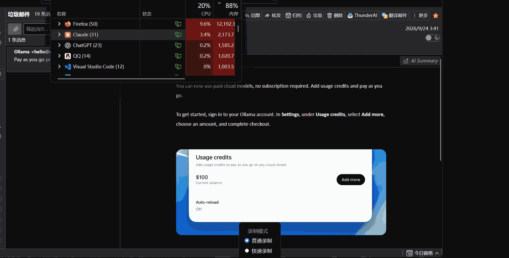

# Thunderbird Translate

[English](../README.md) | [简体中文](README.zh-CN.md) | [繁體中文](README.zh-TW.md) | [日本語](README.ja.md) | [한국어](README.ko.md) | Français | [Deutsch](README.de.md) | [Español](README.es.md) | [Português (Brasil)](README.pt-BR.md) | [Русский](README.ru.md) | [Türkçe](README.tr.md) | [Tiếng Việt](README.vi.md)

Thunderbird Translate est une extension Thunderbird qui traduit le corps du message en cours de lecture, directement dans le panneau de lecture. La traduction peut s’afficher sous chaque paragraphe original (mode bilingue) ou le remplacer (mode traduction seule). Désactiver la traduction restaure exactement le message original. La traduction se fait sur trois niveaux en même temps : un dictionnaire hors ligne, un traducteur automatique (Google Translate, Microsoft Translator, DeepLX ou les modèles hors ligne Bergamot) et un service d’IA (22 fournisseurs, dont OpenAI, Claude, Gemini, DeepSeek et Qwen). Le résultat le plus rapide s’affiche en premier, puis le résultat du niveau le plus élevé le remplace. Google Translate (gratuit) est le service par défaut et fonctionne dès l’installation.

Ce document s’adresse à des lecteurs qui n’ont encore jamais utilisé d’extension Thunderbird. Il suit l’ordre installation, utilisation, configuration, puis fonctionnement interne.



## Fonctionnalités

- Traduction du corps du message : l’extension repère le contenu de niveau paragraphe dans le corps du message : paragraphes, éléments de liste, cellules de tableau, titres, citations, blocs div contenant uniquement du texte, et paragraphes séparés par une ligne vide dans les messages en texte brut. Le code, les paragraphes déjà dans la langue cible, les nombres, les liens nus et les espaces sont ignorés.
- Deux modes d’affichage : le mode bilingue insère sous l’original un bloc de traduction marqué d’une fine bordure gauche, lisible aussi avec les thèmes sombres. Le mode traduction seule remplace l’original par la traduction ; l’original est conservé en mémoire et remis en place lorsque la traduction est désactivée.
- Mises à jour en direct : changer le mode d’affichage ou la langue cible pendant qu’un message est traduit actualise la page sans rouvrir le message. Changer le mode d’affichage redessine la page à partir des traductions déjà reçues et n’envoie aucune nouvelle requête.
- Points d’accès : le bouton « Traduire le message » de la barre d’outils de l’en-tête du message, avec sa fenêtre contextuelle, et les raccourcis Alt+A (traduire / afficher l’original) et Alt+S (basculer entre bilingue et traduction seule).
- Traduire automatiquement à l’ouverture (facultatif) : les messages qui ne sont pas dans la langue cible sont traduits dès leur ouverture.
- Regroupement des requêtes : le script d’arrière-plan collecte les paragraphes pendant 50 ms et les fusionne en une seule requête, avec une limite de requêtes simultanées, de nouvelles tentatives à intervalle exponentiel et un cache local.
- Trois niveaux de traduction : dictionnaire, traduction automatique et IA. Chaque niveau a son propre service ou n’est pas utilisé ; chaque paragraphe est envoyé en même temps à tous les niveaux utilisés. Un niveau inférieur s’affiche comme traduction provisoire jusqu’à ce que le niveau le plus élevé la remplace, et reste affiché lorsque le niveau le plus élevé échoue.
- Services : un dictionnaire hors ligne, 4 traducteurs automatiques (Google Translate, Microsoft Translator, DeepLX, modèles hors ligne Bergamot) et 22 préréglages de fournisseurs d’IA, dont « Service personnalisé compatible OpenAI ». Seuls les services que vous avez ajoutés apparaissent dans les listes des niveaux.
- Langue source : détection automatique ou langue fixée, transmise à chaque service.
- Trois invites pour le niveau IA : une pour l’affichage bilingue, une pour l’affichage de la traduction seule et une pour la traduction précise.
- Préréglages d’invite : des règles prêtes à l’emploi pour une variante régionale de la langue cible, pour les mots difficiles suivis de l’original entre parenthèses, pour de courtes explications des mots difficiles et pour quatre styles d’écriture, à ajouter à l’une des trois invites.
- Guide de configuration : il s’ouvre après l’installation et règle pas à pas les langues, le mode d’affichage, les niveaux, les téléchargements hors ligne, les services et les invites ; il se termine par la traduction d’essai d’un message d’exemple.
- Traduction précise (niveau IA) : le message entier sert de contexte à chaque requête, de sorte que les noms, les termes et les formes d’adresse restent cohérents d’un paragraphe à l’autre.
- Commutateur du mode réflexion pour chaque fournisseur d’IA, désactivé par défaut.
- Interface en 12 langues. La langue de l’interface suit celle de Thunderbird par défaut et peut être choisie sur la page de paramètres.

## Installation

### Depuis les Releases

1. Téléchargez le dernier fichier `thunderbird-translate-<version>.xpi` depuis la page Releases de ce dépôt.
2. Dans Thunderbird, ouvrez Outils → Modules complémentaires et thèmes (aussi accessible depuis le menu ≡ en haut à droite).
3. Cliquez sur l’icône d’engrenage au-dessus de la liste des extensions, choisissez « Installer un module depuis un fichier… », sélectionnez le fichier xpi téléchargé et confirmez.

Thunderbird 128 ou une version ultérieure est nécessaire.

### Compiler depuis les sources

Node.js 22 ou une version ultérieure est nécessaire (le développement se fait avec Node 24 et npm 11).

```bash
npm ci
npm test
npm run build
```

`npm run build` regroupe avec esbuild le script d’arrière-plan, le script de contenu, la fenêtre contextuelle, la page de paramètres et le guide de configuration dans `dist/`, génère `dist/_locales/<language>/messages.json` à partir des fichiers de `locales/`, puis empaquette `dist/` dans `web-ext-artifacts/thunderbird-translate-<version>.xpi`. L’empaquetage utilise la bibliothèque fflate, écrite en JavaScript pur, et ne nécessite aucune commande zip du système.

Pendant le développement, vous pouvez charger l’extension sans l’empaqueter : dans Thunderbird, ouvrez Outils → Outils de développement → Déboguer les modules, cliquez sur « Charger un module temporaire… » et sélectionnez `dist/manifest.json`.

## Guide de configuration

Après une nouvelle installation, Thunderbird ouvre le guide de configuration dans un onglet. Les mises à jour de l’extension ou de Thunderbird ne l’ouvrent pas. Le guide reste accessible ensuite par le lien « Guide de configuration » de la fenêtre contextuelle et par le bouton « Guide de configuration » en haut de la page de paramètres.

Chaque étape demande une seule décision et l’enregistre aussitôt. On navigue entre les étapes de trois façons :

- « Précédent », « Suivant » et « Passer cette étape » passent d’une étape à l’autre.
- La liste numérotée sous la barre de progression mène directement à n’importe quelle étape.
- « Quitter le guide » ferme l’onglet à tout moment.

La visite suivante reprend à l’étape où le guide a été quitté. Après « Terminer », elle recommence au début.

| Étape | Contenu | Affichée lorsque |
| --- | --- | --- |
| 1 Langues | langue de l’interface, langue source (« Détecter automatiquement » par défaut), langue cible | toujours |
| 2 Affichage | bilingue ou traduction seule, avec un aperçu d’un message d’exemple dans le style de traduction actuel | toujours |
| 3 Niveaux de traduction | vitesse, qualité, confidentialité et coût des niveaux dictionnaire, traduction automatique et IA ; le service de chaque niveau ou « Non utilisé », avec au moins un niveau doté d’un service | toujours |
| 4 Traduction hors ligne | les packs de dictionnaires et les directions Bergamot nécessaires aux langues de l’étape 1, avec taille, licence et attribution ; on coche ceux à télécharger, puis « Télécharger la sélection » les télécharge en affichant la progression | le niveau dictionnaire est utilisé, ou le niveau traduction automatique utilise Bergamot |
| 5 Traduction automatique en ligne | les champs du traducteur automatique : rien à remplir pour Google, mode gratuit ou mode avec clé Azure pour Microsoft, point de terminaison et jeton pour DeepLX ; « Tester la connexion » | le niveau traduction automatique utilise Google, Microsoft ou DeepLX |
| 6 Traduction par l’IA | le fournisseur d’IA, sa clé d’API, le modèle, la température et le mode réflexion, « Tester la connexion » et l’option « Traduction précise » ; une remarque indique que le mode réflexion et la traduction précise rendent la traduction plus lente et plus coûteuse | le niveau IA est utilisé |
| 7 Invites | les trois invites et la bibliothèque de préréglages (voir Préréglages d’invite) | le niveau IA est utilisé |
| 8 Terminé | la façon de traduire (bouton de la barre d’outils, Alt+A, Alt+S), l’option « Traduire automatiquement les messages qui ne sont pas dans la langue cible » et « Traduire le message d’exemple » | toujours |

Une étape dont les choix précédents n’ont pas besoin reste dans la liste, barrée, et la navigation la saute. Par exemple, choisir un service d’IA à l’étape 3 fait revenir les étapes 6 et 7.

Avec le japonais comme langue source et le chinois simplifié comme langue cible, l’étape 4 recommande les téléchargements suivants :

- Dictionnaire : le pack japonais → chinois lorsque la publication le contient, sinon les deux packs japonais → anglais et anglais → chinois.
- Bergamot : les directions ja → en et en → zh-Hans, car chaque modèle Bergamot a l’anglais d’un côté.

Avec « Détecter automatiquement », l’étape 4 recommande les packs et les directions à partir de l’anglais. Une remarque demande alors d’installer la direction vers l’anglais de chaque autre langue que vous recevez.

« Traduire le message d’exemple », à l’étape 8, affiche dans la page un court e-mail en anglais (en allemand lorsque la langue cible est l’anglais) et le traduit avec les paramètres actuels. La page utilise la détection des paragraphes et le rendu du script de contenu. Elle envoie les requêtes au script d’arrière-plan par la même connexion qu’un message affiché. Le résultat montre donc l’aspect qu’aura un vrai message, niveaux utilisés compris.

Le guide utilise les mêmes composants que la page de paramètres : les champs des services et le test de connexion, les listes des dictionnaires et de Bergamot, et l’éditeur d’invites avec ses préréglages.

## Utilisation

Ouvrez un message. Un bouton « Traduire le message » apparaît dans la barre d’outils de l’en-tête du message. Un clic sur ce bouton ouvre une fenêtre contextuelle avec les commandes suivantes :

- « Traduire ce message » : lance la traduction. Tant qu’une traduction est en cours ou affichée, le bouton indique « Afficher l’original » et restaure l’original lorsqu’on clique dessus.
- Affichage : bascule entre bilingue et traduction seule ; le changement s’applique immédiatement au message courant.
- Langue source et langue cible : « Détecter automatiquement » est la langue source par défaut. Après un changement de l’une ou de l’autre, un message en cours de traduction est traduit à nouveau. Une remarque s’affiche lorsque les deux langues sont identiques.
- Niveaux de traduction : une liste par niveau (1 Dictionnaire, 2 Traduction automatique, 3 Traduction par l’IA), chacune avec « Non utilisé » et les services ajoutés de ce niveau. Au moins un niveau doit avoir un service ; choisir « Non utilisé » pour le dernier niveau utilisé est refusé avec une remarque. « + Ajouter un service de traduction » sous les listes ouvre la page de paramètres sur les services de traduction.
- Traduction précise : affichée lorsque le niveau IA a un service.
- Traduire automatiquement les messages qui ne sont pas dans la langue cible : lorsque cette case est cochée, un message dont le corps n’est pas dans la langue cible est traduit dès son ouverture.
- Guide de configuration : ouvre le guide de configuration dans un nouvel onglet.

La fenêtre contextuelle affiche la progression, par exemple « 8 sur 12 traduits ». Les paragraphes qui affichent encore la traduction provisoire d’un niveau inférieur sont comptés à part, par exemple « 7 sur 9 traduits (2 provisoires) ». Lorsque tous les niveaux échouent pour un paragraphe, la mention rouge « Échec de la traduction, cliquez pour réessayer » apparaît après lui ; le survol affiche l’erreur et un clic relance la traduction de ce paragraphe.

Alt+A traduit le message courant ou restaure l’original ; Alt+S bascule entre bilingue et traduction seule. Les deux raccourcis se modifient via « Gérer les raccourcis d’extensions » dans le menu d’engrenage du gestionnaire de modules complémentaires.

En mode traduction seule, le survol d’une traduction affiche le texte original dans une infobulle.

## Paramètres

Ouvrez la page de paramètres avec le bouton « Options » de cette extension dans le gestionnaire de modules complémentaires. Les paramètres sont enregistrés automatiquement ; « Enregistré » s’affiche en haut à droite une fois l’écriture terminée. Le bouton « Guide de configuration », à côté de cette mention, ouvre le guide de configuration.

| Section | Contenu |
| --- | --- |
| Général | Langue de l’interface, langue source, langue cible, mode d’affichage par défaut, option « Traduire automatiquement les messages qui ne sont pas dans la langue cible » |
| Niveaux de traduction | Le service de chaque niveau ou « Non utilisé » ; traduction précise |
| Services de traduction | Services répartis en deux groupes, « Ajoutés » et « Disponibles » ; point de terminaison, clé d’API, modèle, température et mode réflexion de chaque service ; boutons « Tester la connexion », « Ajouter », « Utiliser ce service » et « Retirer » |
| Dictionnaires | Paires de langues du niveau dictionnaire, avec taille, licence et attribution ; téléchargement et suppression ; étiquette de version des packs (avancé) |
| Modèles de traduction hors ligne (Bergamot) | Paires de directions des modèles Bergamot, avec taille et version ; filtre par langue ; téléchargement, mise à jour, annulation et suppression ; directions nécessaires aux langues actuelles |
| Invites (niveau IA) | La bibliothèque de préréglages ; les invites de l’affichage bilingue, de l’affichage de la traduction seule et de la traduction précise, chacune avec « Rétablir l’invite intégrée » |
| Regroupement des requêtes | Fenêtre de collecte, nombre maximal de caractères et de paragraphes par requête, requêtes simultanées, nouvelles tentatives, fusion ou non des requêtes d’IA |
| Style de traduction | Bordure gauche, bordure gauche en tirets, surlignage ou sans style ; couleur d’accentuation, opacité du texte, taille de police relative ; aperçu en direct |
| Cache | Cache activé ou désactivé, nombre maximal de paragraphes en cache, nombre actuel d’entrées, vidage du cache |

« Tester la connexion » envoie une phrase de test avec les valeurs actuellement saisies dans les champs. En cas de succès, le bouton affiche la traduction ; en cas d’échec, il affiche l’erreur renvoyée par le service, par exemple une clé non valide ou un nom de modèle inconnu.

## Ajout et retrait de services

La liste latérale de la section des services de traduction comporte deux groupes. « Ajoutés » contient les services qui apparaissent dans les listes de services de la fenêtre contextuelle et de la page de paramètres ; « Disponibles » contient tous les autres. Sélectionner un service affiche sa configuration et ses boutons :

- Un service qui n’est pas ajouté a un bouton « Ajouter ». Saisir une clé d’API (pour DeepLX, le point de terminaison) ajoute aussi le service.
- Un service ajouté a « Utiliser ce service », qui le place dans son niveau, et « Retirer ». Retirer un service le sort des listes et conserve sa configuration ; en l’ajoutant de nouveau, on retrouve la clé et le modèle.
- Un service utilisé par un niveau ne peut pas être retiré. Le bouton « Retirer » est alors désactivé et une ligne en dessous nomme le niveau. Les services utilisés portent l’étiquette « Utilisé » dans la liste latérale.

Une installation neuve commence avec Google Translate et Microsoft Translator ajoutés. Le dictionnaire et Bergamot ont besoin de données que vous téléchargez ; ils s’ajoutent donc à la main. Lorsque les paramètres de la version 1.1 ou antérieure sont chargés, un service compte comme ajouté dans les cas suivants :

| Service | Compte comme ajouté lorsque |
| --- | --- |
| Google Translate, Microsoft Translator | toujours |
| DeepLX | un point de terminaison est renseigné |
| Services d’IA qui exigent une clé | une clé d’API est enregistrée |
| Ollama, LM Studio, service personnalisé compatible OpenAI | le point de terminaison, le modèle ou la température a été modifié |
| les services des niveaux | toujours |

## Niveaux de traduction

| Niveau | Services | Ce qu’il fournit |
| --- | --- | --- |
| 1 Dictionnaire | Dictionnaire (hors ligne) | une traduction mot à mot tirée des packs de dictionnaires installés, disponible immédiatement et sans réseau |
| 2 Traduction automatique | Google Translate, Microsoft Translator, DeepLX, Bergamot (hors ligne) | une traduction complète en une ou deux secondes |
| 3 Traduction par l’IA | les 22 fournisseurs d’IA | la meilleure traduction, qui suit l’invite du mode d’affichage |

Chaque niveau a un service ou « Non utilisé », et au moins un niveau a un service. Par défaut, seul le niveau 2 a un service, Google Translate.

Chaque paragraphe est envoyé en même temps à tous les niveaux utilisés. Chaque niveau passe par le regroupement et le cache habituels. Ce que le message affiche suit une seule règle : le niveau le plus élevé qui a répondu l’emporte.

| Cas | Ce que le message affiche |
| --- | --- |
| Un niveau inférieur répond en premier | sa traduction, en italique avec une étiquette qui nomme son niveau (« Dictionnaire », « Traduction automatique ») ; le survol indique le niveau encore en cours. Un niveau supérieur la remplace à son arrivée. |
| Le niveau le plus élevé utilisé répond | sa traduction, sans étiquette : c’est la traduction définitive. Les niveaux inférieurs qui répondent ensuite sont ignorés. |
| Le niveau le plus élevé échoue | la meilleure traduction d’un niveau inférieur reste, marquée « Échec : Traduction par l’IA » (ou avec le nom du niveau le plus élevé) ; le survol affiche la raison, un clic relance uniquement les niveaux en échec |
| Tous les niveaux échouent | la mention rouge « Échec de la traduction, cliquez pour réessayer » |
| La traduction du niveau le plus élevé est déjà en cache | cette traduction, immédiatement ; les niveaux inférieurs ne sont pas sollicités |

Changer le mode d’affichage redessine telles quelles les traductions du dictionnaire et de la traduction automatique. Le niveau IA utilise une invite par mode d’affichage : il est donc sollicité de nouveau avec l’invite du nouveau mode, et une traduction déjà en cache pour cette invite revient sans requête. La fenêtre contextuelle compte les traductions définitives comme traduites et celles des niveaux inférieurs comme provisoires.

Les paramètres enregistrés par la version 1.3 ou antérieure sont convertis une seule fois :

- Un service d’IA qui était le service actuel devient le niveau 3. Si la traduction en course était activée, son service rapide devient le niveau 2.
- Tout autre service actuel devient le niveau 2.
- Le niveau dictionnaire commence non utilisé.

## Langue source

La langue source est « Détecter automatiquement » par défaut, ou l’une des 20 langues de la liste des langues cibles. Elle est transmise à chaque service :

| Service | Détection automatique | Langue fixée |
| --- | --- | --- |
| Google Translate | `sl=auto` | `sl=<code>` |
| Microsoft Translator, gratuit et avec clé | pas de paramètre `from` | `from=<code>` |
| DeepLX | `source_lang: "auto"` | `source_lang: "<code>"` (variantes du chinois sous la forme `ZH`) |
| Services d’IA | « Detect the source language of … and translate it into … » | « Translate … from <language> into … » |
| Dictionnaire | détectée pour chaque paragraphe | la langue définie |
| Bergamot | `"auto"`, avec en repli la langue déduite de l’écriture et des mots vides anglais | la langue définie |

Les paragraphes détectés comme étant dans la langue cible sont ignorés, comme auparavant. Avec une langue source fixée, les paragraphes dont la langue ne peut pas être détectée de façon fiable sont traités comme étant dans cette langue. Les clés de cache et les lots contiennent la langue source ; un changement de langue source ne renvoie donc jamais de traductions faites pour l’ancien réglage.

## Invites

Le niveau IA a trois invites système. Chacune se modifie sur la page de paramètres et se rétablit avec « Rétablir l’invite intégrée » ; un champ vide signifie aussi l’invite intégrée. `{{to}}` est remplacé par le nom anglais de la langue cible. L’extension ajoute elle-même la langue source et le format de regroupement à chaque requête.

| Invite | Utilisée pour | L’invite intégrée demande |
| --- | --- | --- |
| Affichage bilingue | le niveau IA en mode bilingue | une traduction proche de l’original, phrase par phrase et dans le même ordre, sans rien ajouter ni retrancher, puisque le lecteur la compare avec l’original |
| Affichage de la traduction seule | le niveau IA en mode traduction seule | un texte fluide qui se lit comme un message écrit dans la langue cible ; les propositions peuvent être réordonnées et les phrases scindées ou réunies, à condition de conserver le sens complet |
| Traduction précise | le niveau IA tant que la traduction précise est activée, dans les deux modes d’affichage | des termes, des noms et des formes d’adresse cohérents dans tout le message, à l’aide du glossaire, du résumé et des paragraphes voisins |

Les clés de cache et les clés de lot contiennent le type d’invite et une empreinte de son texte. Modifier une invite ne renvoie donc jamais de traductions faites avec l’ancien texte. Une invite système personnalisée enregistrée par la version 1.3 ou antérieure devient l’invite des deux modes d’affichage ; l’invite de traduction précise commence avec son texte intégré.

### Préréglages d’invite

La bibliothèque de préréglages se trouve au-dessus des trois invites sur la page de paramètres, et à l’étape 7 du guide de configuration. Pour appliquer un préréglage :

1. Choisissez un préréglage dans « Préréglage ». Si le préréglage a des variantes, choisissez aussi une variante dans « Variante ».
2. Choisissez dans « Ajouter à l’invite » l’invite qui reçoit le préréglage.
3. Cliquez sur « Appliquer le préréglage ».

La ligne « Exemple » montre une phrase source et le résultat attendu avec le préréglage choisi.

| Préréglage | Variantes | Règle ajoutée à l’invite |
| --- | --- | --- |
| Dialecte ou usage régional | selon la langue cible : cantonais (Hong Kong) et sichuanais pour le chinois simplifié ; cantonais (Hong Kong) et usage de Taïwan pour le chinois traditionnel ; anglais britannique et anglais américain ; portugais du Brésil et portugais européen ; espagnol du Mexique et espagnol d’Espagne ; français canadien (Québec) ; allemand standard suisse | rédiger dans cette variante, avec son orthographe, son vocabulaire et ses formes d’adresse |
| Mots difficiles avec l’original | aucune | traduire normalement et mettre le terme original entre parenthèses après chaque mot difficile ou terme technique, une fois par paragraphe, par exemple « audit préalable (due diligence) » |
| Explication des mots difficiles | aucune | traduire le paragraphe, puis expliquer ses mots difficiles dans la langue cible à la fin du même paragraphe, dans une seule paire de crochets : 〔Note : terme : explication ; …〕 |
| Style d’écriture | professionnel soutenu, familier, langage simple pour apprenants, littéraire | adopter ce registre et conserver le sens complet |

La liste des variantes suit la langue cible. Une langue cible sans variantes, comme le japonais, ne propose pas le préréglage « Dialecte ou usage régional ».

Un préréglage ajoute un bloc de règles en anglais à la fin de l’invite, après une ligne vide. Le bloc commence par un titre comme `Style (this rule takes precedence over the rules above):`. Il l’emporte donc sur les règles générales de l’invite intégrée, comme « Do not add explanations ». Appliquer de nouveau le même préréglage remplace son bloc ; des préréglages différents s’additionnent. Le champ de l’invite affiche le texte combiné et reste modifiable. « Rétablir l’invite intégrée » retire tous les ajouts.

Les préréglages conservent une traduction par paragraphe. Les explications des mots difficiles restent dans la traduction de leur paragraphe, et le bloc interdit de les renvoyer comme paragraphe ou élément de tableau séparé. Un lot revient donc toujours sous forme de tableau JSON (ou de segments numérotés) avec exactement une entrée par paragraphe. Les tests appliquent les quatre préréglages à une même invite et analysent la réponse d’un modèle simulé dans les deux formats.

## Traduction précise

La traduction précise s’applique au niveau IA et envoie le message comme contexte avec chaque requête d’IA. Elle s’active dans la fenêtre contextuelle ou dans la section « Niveaux de traduction » de la page de paramètres. Au début de la traduction, le script de contenu assemble les paragraphes trouvés en texte brut du message (coupé après 20 000 caractères, avec une mention que le texte se poursuit) et l’enregistre une seule fois auprès du script d’arrière-plan. Le message est identifié par une empreinte de son texte complet ; la coupure ne concerne que le texte envoyé comme contexte.

Le déroulement dépend de la taille des paragraphes à traduire :

1. S’ils tiennent dans une seule requête (dans les limites de « Nombre maximal de caractères par requête » et « Nombre maximal de paragraphes par requête »), une requête les traduit tous ; la requête porte elle-même le message entier.
2. Sinon, une requête supplémentaire analyse d’abord le message entier et renvoie un résumé de deux à trois phrases, un glossaire des noms, produits et autres noms propres avec la traduction à employer, ainsi que le ton et la forme d’adresse. Si cette réponse est illisible, la traduction se poursuit sans elle.
3. Chaque requête commence alors par le même préfixe : l’invite système, l’analyse et, pour les messages d’environ 8 000 caractères au plus, le texte complet. Après le préfixe viennent les paragraphes du lot, chacun avec le paragraphe qui le précède et celui qui le suit comme référence non traduite.

Le préfixe est identique, caractère pour caractère, pour toutes les requêtes d’un même message ; les fournisseurs qui mettent en cache les préfixes d’invite répétés peuvent donc le servir depuis leur cache. Pour Anthropic, le préfixe est marqué par `cacheControl: { type: "ephemeral" }`. L’analyse est mise en cache comme les traductions, avec pour clé le fournisseur, le modèle, la langue cible et l’empreinte du texte du message ; les lots d’un même message attendent la même requête d’analyse.

Les traductions faites en mode précis sont mises en cache sous une clé qui contient l’empreinte du message, et les lots ne mélangent jamais les paragraphes de messages différents. La même phrase dans un autre message est donc traduite de nouveau, avec ce message pour contexte. La requête d’analyse et les invites plus longues rendent la traduction précise plus coûteuse que la traduction normale.

## Traduction par dictionnaire

Le service de dictionnaire traduit mot à mot avec des packs de dictionnaires stockés dans le profil Thunderbird. Une fois un pack installé, il n’a besoin d’aucun réseau et répond en quelques millisecondes ; il comble ainsi l’attente jusqu’à la réponse des niveaux traduction automatique et IA. Le résultat est une glose : les mots dans l’ordre de la source, sans grammaire.

### Packs

Les packs sont publiés comme fichiers joints d’une release GitHub de ce dépôt, par défaut la release `dicts-v1`. L’étiquette de version se change sous « Étiquette de version des packs de dictionnaires (avancé) » dans la section Dictionnaires. Chaque direction correspond à un fichier `dict-<src>-<tgt>.tsv.gz`, un fichier texte UTF-8 compressé avec gzip :

```text
#dict	<src>	<tgt>	<packVersion>	<sourceName>	<license>
w	<key>	<translation>
f	<key>	<lemmaKey>
```

Les lignes ont les rôles suivants :

- La première ligne décrit le pack : langue source, langue cible, version, source des données et licence.
- Les lignes qui commencent par `w` sont des entrées.
- Les lignes qui commencent par `f` associent une forme fléchie à la clé de son lemme, par exemple `went` à `go`.

Une clé est normalisée en NFC, mise en minuscules selon les règles de la langue source et débarrassée des espaces en début et en fin ; elle peut être une expression de plusieurs mots. L’index `dict-index.json` liste chaque pack avec sa taille, son nombre d’entrées et de formes, sa somme de contrôle SHA-256, sa source, sa licence et son attribution. Les packs couvrent l’anglais, le chinois simplifié et traditionnel, le japonais, le coréen, le français, l’allemand, l’espagnol, le portugais, le russe, le turc et le vietnamien. [docs/dictionary-packs.md](../docs/dictionary-packs.md) décrit leur construction.

La section Dictionnaires lit l’index et liste chaque pack avec sa taille, sa licence et son attribution. « Télécharger » récupère le fichier en affichant la progression, vérifie sa somme de contrôle SHA-256 et son en-tête, puis le stocke dans la base IndexedDB `tt-dictionary` de l’extension ; « Supprimer » le retire. Si l’index ne peut pas être chargé, la section en indique la raison, et les packs installés peuvent toujours être supprimés.

### Traduction

1. La langue source est celle qui est définie ou, avec la détection automatique, la langue du paragraphe (écriture, détecteur du navigateur, mots vides anglais).
2. `Intl.Segmenter` découpe le paragraphe en mots. À chaque mot, l’expression la plus longue d’au plus trois mots qui a une entrée l’emporte, sinon le mot seul. Un mot sans entrée est recherché via son lemme ; si cette recherche échoue aussi, il reste tel quel. La ponctuation et les nombres restent tels quels.
3. Pour une langue cible chinoise ou le japonais, les mots sont joints sans espaces ; pour les autres langues cibles, avec des espaces.
4. Entre deux langues autres que l’anglais, le texte passe par l’anglais : du français vers l’allemand, l’extension utilise les packs français → anglais et anglais → allemand.
5. Lorsqu’un pack nécessaire manque, l’erreur nomme la paire de langues et renvoie à la section Dictionnaires.

Le script d’arrière-plan lit un pack depuis IndexedDB à sa première utilisation et le garde en mémoire ; après cinq minutes sans traduction par dictionnaire, il libère cette mémoire.

### Sources des données

Les packs sont construits à partir de deux sources :

- Wiktionary, extrait par wiktextract et publié par kaikki.org (CC BY-SA 4.0, © contributeurs de Wiktionary) ;
- ECDICT de skywind3000 (licence MIT).

Chaque pack indique sa propre source et sa licence dans l’index, et la page de paramètres les affiche à côté du pack.

## Traduction hors ligne (Bergamot)

Le service Bergamot traduit sur votre ordinateur avec le moteur et les modèles de Firefox Translations, publiés par Mozilla sous MPL-2.0. Le moteur est livré avec l’extension ; chaque direction de traduction est téléchargée une seule fois depuis Mozilla (24 à 48 Mo) et stockée dans la base IndexedDB de l’extension. Une direction chargée occupe environ 200 Mo de mémoire et est libérée après cinq minutes sans utilisation. Chaque modèle a l’anglais d’un côté : du japonais vers le chinois, le service utilise donc japonais → anglais et anglais → chinois.

La section « Modèles de traduction hors ligne (Bergamot) » de la page de paramètres liste les 114 paires de directions entre 58 langues, avec leur taille et leur version, et se filtre par langue. Elle nomme les directions dont la langue source et la langue cible actuelles ont besoin et les place en tête de liste. Les téléchargements affichent leur progression et peuvent être annulés ; une paire installée pour laquelle Mozilla propose une version plus récente affiche « Mettre à jour ». La suppression d’une paire dont les langues actuelles ont besoin demande une confirmation. L’installation, la traduction et la suppression s’exécutent dans le script d’arrière-plan, où se trouve le moteur. [docs/bergamot.md](../docs/bergamot.md) décrit le choix des modèles, leur vérification, leur stockage et le moteur.


## Langue de l’interface

L’option « Langue de l’interface » de la section Général accepte deux types de valeurs :

- « Suivre Thunderbird » (par défaut) : l’extension utilise la langue prise en charge la plus proche de la langue de l’interface de Thunderbird. Le libellé de l’option indique la langue retenue, par exemple « Suivre Thunderbird (Deutsch) ».
- L’une des 12 langues prises en charge : l’extension utilise cette langue quelle que soit la langue de Thunderbird.

Ce choix s’applique à la fenêtre contextuelle, à la page de paramètres, aux libellés affichés dans les messages (« Traduction en cours… », « Échec de la traduction, cliquez pour réessayer »), aux messages d’erreur, au résultat du test de connexion et à l’infobulle du bouton de la barre d’outils. Une page de paramètres ou une fenêtre contextuelle ouverte change de langue immédiatement. Les libellés d’un message déjà traduit changent la prochaine fois qu’ils sont dessinés.

Quelques textes sont lus par Thunderbird lui-même dans le manifeste de l’extension et suivent toujours la langue de l’interface de Thunderbird : le nom et la description de l’extension dans le gestionnaire de modules complémentaires, ainsi que les descriptions des raccourcis dans « Gérer les raccourcis d’extensions ». La page de paramètres le précise sous l’option.

« Suivre Thunderbird » fait correspondre la langue de Thunderbird de la manière suivante :

| Langue de Thunderbird | Langue d’interface utilisée |
| --- | --- |
| `zh-TW`, `zh-HK`, `zh-MO`, `zh-Hant` | Chinois traditionnel |
| autres `zh-*` | Chinois simplifié |
| `pt-*` | Portugais (Brésil) |
| `en-*`, `ja`, `ko`, `fr-*`, `de-*`, `es-*`, `ru`, `tr`, `vi` | la langue ayant la même sous-étiquette principale |
| toute autre langue | Anglais |

La liste des langues cibles affiche le nom de chaque langue dans la langue de l’interface, suivi de son nom dans la langue elle-même, par exemple « japonais (日本語) ». Les invites envoyées aux services d’IA utilisent toujours le nom anglais de la langue, car les modèles suivent le plus fiablement des instructions en anglais.

Lors de la première installation, la langue cible est déterminée à partir de la langue de l’interface : un Thunderbird en japonais démarre avec le japonais comme langue cible, un Thunderbird en anglais avec l’anglais. Une langue cible déjà définie n’est jamais écrasée.

## Langues d’interface prises en charge

| Code | Langue |
| --- | --- |
| `en` | English (anglais) |
| `zh_CN` | 简体中文 (chinois simplifié) |
| `zh_TW` | 繁體中文 (chinois traditionnel) |
| `ja` | 日本語 (japonais) |
| `ko` | 한국어 (coréen) |
| `fr` | Français (français) |
| `de` | Deutsch (allemand) |
| `es` | Español (espagnol) |
| `pt_BR` | Português (Brasil) (portugais, Brésil) |
| `ru` | Русский (russe) |
| `tr` | Türkçe (turc) |
| `vi` | Tiếng Việt (vietnamien) |

La liste des langues cibles est distincte et compte 20 langues, dont l’italien, l’ukrainien, le polonais, le néerlandais, le thaï, l’indonésien, l’arabe et l’hindi.

## Configuration des fournisseurs

### Services gratuits et auto-hébergés

| Service | Configuration | Remarques |
| --- | --- | --- |
| Google Translate (gratuit, par défaut) | Aucune | Appelle le point de terminaison `client=gtx` de `translate.googleapis.com` ; une requête POST transporte plusieurs paramètres `q`, si bien que plusieurs paragraphes partagent une même requête |
| Dictionnaire (hors ligne) | Télécharger des paires de langues dans la section Dictionnaires | Traduction mot à mot avec les packs installés, voir « Traduction par dictionnaire » |
| Bergamot (hors ligne) | Télécharger des paires de directions dans la section « Modèles de traduction hors ligne » | Traduction sur votre ordinateur avec les modèles de Mozilla, voir « Traduction hors ligne (Bergamot) » |
| Microsoft Translator (gratuit) | Aucune | Appelle `edge.microsoft.com/translate/translatetext`, le point de terminaison qu’utilise le navigateur Edge ; le corps de la requête est un tableau de paragraphes. L’option « Utiliser ma clé (Azure Translator) » du panneau appelle à la place l’API officielle `api.cognitive.microsofttranslator.com` : créez une ressource Translator dans le portail Azure, puis copiez sa clé et sa région depuis « Clés et point de terminaison » dans le panneau (la région peut rester vide pour une ressource globale). |
| DeepLX | Point de terminaison obligatoire | Un service DeepLX auto-hébergé ou tiers ; le jeton est facultatif. Si le point de terminaison contient `{{apiKey}}`, le jeton le remplace ; sinon, il est envoyé dans l’en-tête `Authorization: Bearer` |

### Fournisseurs d’IA

Tous les fournisseurs d’IA sont appelés via `generateText` du Vercel AI SDK. Les fournisseurs qui disposent d’un paquet officiel `@ai-sdk/*` utilisent ce paquet ; les autres utilisent `@ai-sdk/openai-compatible`. Le point de terminaison, la clé d’API, le modèle et la température sont modifiables pour chaque fournisseur. Le champ du modèle propose les modèles courants et accepte aussi n’importe quel nom de modèle.

| Fournisseur | Paquet SDK | Point de terminaison par défaut | Modèle par défaut | Clé requise |
| --- | --- | --- | --- | --- |
| OpenAI | `@ai-sdk/openai` | `https://api.openai.com/v1` | `gpt-4.1-mini` | Oui |
| Anthropic Claude | `@ai-sdk/anthropic` | `https://api.anthropic.com/v1` | `claude-haiku-5-5` | Oui |
| Google Gemini | `@ai-sdk/google` | `https://generativelanguage.googleapis.com/v1beta` | `gemini-2.5-flash-lite` | Oui |
| DeepSeek | `@ai-sdk/deepseek` | `https://api.deepseek.com` | `deepseek-flash` | Oui |
| xAI Grok | `@ai-sdk/xai` | `https://api.x.ai/v1` | `grok-3-mini` | Oui |
| Groq | `@ai-sdk/groq` | `https://api.groq.com/openai/v1` | `llama-3.3-70b-versatile` | Oui |
| Mistral AI | `@ai-sdk/mistral` | `https://api.mistral.ai/v1` | `mistral-small-latest` | Oui |
| Ollama (local) | `@ai-sdk/openai-compatible` | `http://localhost:11434/v1` | `qwen2.5:7b` | Non |
| OpenRouter | `@ai-sdk/openai-compatible` | `https://openrouter.ai/api/v1` | `openai/gpt-4.1-mini` | Oui |
| Together AI | `@ai-sdk/togetherai` | `https://api.together.xyz/v1` | `meta-llama/Llama-3.3-70B-Instruct-Turbo` | Oui |
| Fireworks AI | `@ai-sdk/fireworks` | `https://api.fireworks.ai/inference/v1` | `accounts/fireworks/models/llama-v3p3-70b-instruct` | Oui |
| DeepInfra | `@ai-sdk/deepinfra` | `https://api.deepinfra.com/v1` | `meta-llama/Llama-3.3-70B-Instruct-Turbo` | Oui |
| Cerebras | `@ai-sdk/cerebras` | `https://api.cerebras.ai/v1` | `gpt-oss-120b` | Oui |
| Perplexity | `@ai-sdk/perplexity` | `https://api.perplexity.ai` | `perplexity/sonar` | Oui |
| Moonshot / Kimi | `@ai-sdk/moonshotai` | `https://api.moonshot.cn/v1` | `kimi-k2-turbo-preview` | Oui |
| 智谱 GLM (Zhipu) | `@ai-sdk/openai-compatible` | `https://open.bigmodel.cn/api/paas/v4` | `glm-4-flash` | Oui |
| 通义千问 / 阿里云百炼 (DashScope) | `@ai-sdk/alibaba` | `https://dashscope.aliyuncs.com/compatible-mode/v1` | `qwen-plus` | Oui |
| 硅基流动 SiliconFlow | `@ai-sdk/openai-compatible` | `https://api.siliconflow.cn/v1` | `Qwen/Qwen2.5-7B-Instruct` | Oui |
| 火山引擎豆包 (Volcengine Ark) | `@ai-sdk/openai-compatible` | `https://ark.cn-beijing.volces.com/api/v3` | `doubao-1-5-pro-32k-250115` | Oui |
| Azure OpenAI | `@ai-sdk/azure` | À renseigner | `gpt-4.1-mini` | Oui |
| LM Studio (local) | `@ai-sdk/openai-compatible` | `http://localhost:1234/v1` | `qwen2.5-7b-instruct` | Non |
| Service personnalisé compatible OpenAI | `@ai-sdk/openai-compatible` | À renseigner | À renseigner | Non |

Certains fournisseurs ont des exigences supplémentaires :

- Anthropic Claude : l’extension ajoute l’en-tête `anthropic-dangerous-direct-browser-access: true`, qu’Anthropic exige pour les requêtes émises depuis un contexte de navigateur. La série Claude 5 ainsi qu’Opus 4.7 et 4.8 refusent une température personnalisée ; l’extension n’envoie donc pas de température pour ces modèles, et le champ de température du modèle par défaut est vide.
- Azure OpenAI : le point de terminaison est `https://<resource>.openai.azure.com/openai`, et le champ du modèle reçoit le nom du déploiement.
- Ollama : par défaut, Ollama refuse les requêtes d’origine croisée provenant des pages d’extension. Lancez Ollama avec la variable d’environnement `OLLAMA_ORIGINS=moz-extension://*`.
- Moonshot : le point de terminaison par défaut est celui du site chinois `api.moonshot.cn` ; les comptes du site international utilisent `https://api.moonshot.ai/v1`.
- Volcengine Doubao : le champ du modèle reçoit soit un nom de modèle, soit l’identifiant d’un point de terminaison d’inférence créé dans la console Ark.

### Mode réflexion

Chaque fournisseur d’IA a un commutateur « Mode réflexion », désactivé par défaut. La traduction n’exige pas que le modèle raisonne d’abord, et le raisonnement rend les requêtes plus lentes et plus coûteuses. Plusieurs modèles actuels raisonnent sauf instruction contraire, par exemple `deepseek-flash`, `claude-haiku-5-5` et `gemini-2.5-flash` ; la valeur « désactivé » est donc envoyée explicitement.

Chaque fournisseur nomme ce commutateur à sa manière, et chez un même fournisseur seuls certains modèles l’acceptent. L’extension compare le nom du modèle aux motifs ci-dessous et envoie les options du fournisseur de la première correspondance ; un modèle sans correspondance ne reçoit aucun paramètre de réflexion. Lorsque la réflexion est activée, aucune température n’est envoyée aux modèles qui correspondent à un motif du tableau, car les modèles de raisonnement l’ignorent ou la rejettent.

| Fournisseur | Modèles | Désactivé | Activé | Source |
| --- | --- | --- | --- | --- |
| OpenAI, Azure OpenAI | `gpt-5.1` et suivants | `openai.reasoningEffort: "none"` | `"medium"` | [OpenAI reasoning guide](https://developers.openai.com/api/docs/guides/reasoning) |
| | `gpt-5`, `gpt-5-mini`, `gpt-5-nano` | `"minimal"` | `"medium"` | idem |
| | `o1`, `o3`, `o4-mini` … | `"low"` (ne peut pas être désactivé) | `"medium"` | idem |
| Anthropic | série Claude 5, Opus 4.7/4.8 | `anthropic.thinking: { type: "disabled" }` | `{ type: "adaptive" }` | [Extended thinking](https://platform.claude.com/docs/en/build-with-claude/extended-thinking) |
| | Claude 3.7 et 4.x | rien (désactivé par défaut) | `{ type: "enabled", budgetTokens: 1024 }` | idem |
| Google Gemini | `gemini-2.5-pro` | `google.thinkingConfig: { thinkingBudget: 128 }` (minimum, ne peut pas être désactivé) | `{ thinkingBudget: -1 }` | [Gemini thinking](https://ai.google.dev/gemini-api/docs/generate-content/thinking) |
| | autres `gemini-2.5-*` | `{ thinkingBudget: 0 }` | `{ thinkingBudget: -1 }` | idem |
| | Gemini 3 et suivants | `{ thinkingLevel: "low" }` (pas de désactivation complète) | `{ thinkingLevel: "high" }` | idem |
| DeepSeek | tous | `deepseek.thinking: { type: "disabled" }` | `{ type: "enabled" }` | [Thinking mode](https://api-docs.deepseek.com/guides/thinking_mode) |
| xAI Grok | `grok-4.3` | `xai.reasoningEffort: "none"` | `"high"` | [xAI reasoning](https://docs.x.ai/developers/model-capabilities/text/reasoning) |
| | `grok-3-mini` | `"low"` | `"high"` | idem |
| Groq | Qwen3 | `groq.reasoningEffort: "none"` | `"default"` avec `reasoningFormat: "parsed"` | [Groq reasoning](https://console.groq.com/docs/reasoning) |
| | `gpt-oss` | `"low"` | `"medium"` | idem |
| Mistral AI | tous (le SDK ne l’envoie que pour les modèles qui l’acceptent) | `mistral.reasoningEffort: "none"` | `"high"` | [Mistral reasoning](https://docs.mistral.ai/studio/conversations/reasoning) |
| Together AI | Qwen3, GLM-4/5, DeepSeek V4, Kimi K3, MiniMax M3 | `togetherai.reasoning: { enabled: false }` | `{ enabled: true }` | [Together reasoning](https://docs.together.ai/docs/inference/chat/reasoning) |
| Fireworks AI | DeepSeek V3.1/3.2/V4, GLM, Kimi K3, Qwen3 | `fireworks.reasoningEffort: "none"` | `"medium"` | [Fireworks reasoning](https://docs.fireworks.ai/guides/reasoning) |
| | `gpt-oss` | `"low"` | `"medium"` | idem |
| DeepInfra | tous (ignoré par les modèles sans raisonnement) | `deepinfra.reasoningEffort: "none"` | `"high"` | [DeepInfra reasoning](https://docs.deepinfra.com/chat/reasoning) |
| Cerebras | Qwen | `cerebras.reasoningEffort: "none"` | `"medium"` | [Cerebras reasoning](https://inference-docs.cerebras.ai/capabilities/reasoning) |
| | `gpt-oss` | `"low"` | `"medium"` | idem |
| Moonshot / Kimi | `kimi-k2.5`, `kimi-k2.6` | `moonshotai.thinking: { type: "disabled" }` | `{ type: "enabled" }` | [Kimi thinking models](https://platform.kimi.com/docs/guide/use-kimi-k2-thinking-model) |
| | `kimi-k3` | `moonshotai.reasoningEffort: "low"` | `"high"` | idem |
| DashScope | Qwen3, `qwen-plus`, `qwen-flash`, `qwen-turbo` | `alibaba.enableThinking: false` | `true` | [Deep thinking](https://help.aliyun.com/zh/model-studio/deep-thinking) |
| Ollama | tous | `ollama.reasoningEffort: "none"` | `"medium"` | [OpenAI compatibility](https://docs.ollama.com/api/openai-compatibility) |
| OpenRouter | modèles qui raisonnent toujours (`o*`, `gpt-5`, `gpt-oss`, `grok-4`, Claude Opus 5, Gemini 2.5 Pro et 3) | `openrouter.reasoning: { effort: "low" }` | `{ enabled: true }` | [Reasoning tokens](https://openrouter.ai/docs/guides/best-practices/reasoning-tokens) |
| | tous les autres (ignoré par les modèles sans raisonnement) | `{ enabled: false }` | `{ enabled: true }` | idem |
| Zhipu GLM | GLM-4.5 et suivants | `zhipu.thinking: { type: "disabled" }` ; rien pour GLM-5.3, qui le rejette | `{ type: "enabled" }` | [GLM thinking](https://docs.bigmodel.cn/cn/guide/capabilities/thinking) |
| SiliconFlow | Qwen3, DeepSeek V3.1/3.2/V4, GLM-4.5+, Hunyuan-A13B, Kimi K2 | `siliconflow.enable_thinking: false` | `true` | [Chat completions](https://docs.siliconflow.cn/cn/api-reference/chat-completions/chat-completions) |
| Volcengine Doubao | modèles Seed et modèles à réflexion | `doubao.thinking: { type: "disabled" }` | `{ type: "enabled" }` | [Ark documentation](https://www.volcengine.com/docs/82379) |

Perplexity, LM Studio et les services personnalisés compatibles OpenAI n’ont aucun paramètre de réflexion documenté sur le point de terminaison que l’extension utilise. Leur commutateur est désactivé, et la page de paramètres l’indique.

Pour les préréglages compatibles OpenAI (Ollama, OpenRouter, Zhipu, SiliconFlow, Doubao), les options sont écrites sous l’identifiant du préréglage, et `@ai-sdk/openai-compatible` les copie telles quelles dans le corps de la requête ; `reasoningEffort` est la seule clé qu’il renomme, en `reasoning_effort`.

## Fonctionnement du regroupement

Un message compte en général entre une dizaine et quelques dizaines de paragraphes. Avec une requête par paragraphe, chaque paragraphe transporte sa propre copie de l’invite système et des instructions, et chaque paragraphe consomme une requête sur la limite de débit. Le regroupement fusionne en une seule requête les paragraphes qui arrivent à peu d’intervalle, de sorte que ces deux coûts sont payés une fois par lot plutôt qu’une fois par paragraphe.

### Déroulement

1. Le script de contenu transmet au script d’arrière-plan chaque paragraphe à traduire, une seule fois pour tous les niveaux utilisés.
2. Pour chaque niveau, le script d’arrière-plan consulte d’abord le cache et répond directement en cas de succès. La clé de cache se compose du fournisseur, du modèle, des langues source et cible, pour les services d’IA du type d’invite et d’une empreinte de son texte, en mode précis de l’empreinte du message, et d’une empreinte du texte du paragraphe. Lorsque le même texte est déjà en cours de traduction, les requêtes suivantes partagent le même résultat.
3. Les paragraphes absents du cache entrent dans la file de regroupement, groupés par fournisseur + modèle + point de terminaison + langue source + langue cible, pour les services d’IA aussi par invite, pour Microsoft Translator aussi par mode gratuit ou avec clé, et en mode précis aussi par message. Les paragraphes d’un même groupe s’accumulent pendant 50 ms. Un groupe est envoyé à la fin de la fenêtre, lorsque la limite de paragraphes est atteinte ou lorsque le paragraphe suivant dépasserait la limite de caractères. Un paragraphe seul plus long que la limite de caractères forme son propre lot.
4. La file de requêtes exécute chaque lot. Elle limite le nombre de requêtes simultanées et retente les erreurs 408, 429, 5xx et réseau avec un intervalle exponentiel ; lorsque le serveur envoie `Retry-After`, elle attend la durée indiquée, dans la limite de 30 secondes. Les erreurs comme 401 et 400 sont signalées sans nouvelle tentative.
5. Les résultats sont placés dans le cache en mémoire et écrits dans `storage.local` en une seule écriture au bout d’une seconde. Le cache évince les entrées les moins récemment utilisées (LRU, Least Recently Used).

### Fusion des paragraphes selon le service

- Dictionnaire et Bergamot : le lot entier est traduit en un seul appel local.
- Google : une requête POST avec plusieurs paramètres `q` ; le tableau renvoyé correspond un à un aux entrées.
- Microsoft : le corps de la requête est lui-même un tableau.
- DeepLX : le point de terminaison accepte un paragraphe par requête ; les paragraphes d’un lot sont donc demandés en parallèle.
- Fournisseurs d’IA : les paragraphes sont numérotés et placés dans un seul message, et le modèle doit renvoyer un tableau JSON de même longueur. L’analyseur essaie, dans l’ordre : un tableau JSON (éventuellement dans un bloc de code ou entouré d’explications ; les sauts de ligne bruts dans les chaînes et les virgules finales sont réparés), des blocs `<seg>` numérotés, des lignes numérotées, puis le séparateur `%%`. Si toutes ces méthodes échouent ou si le nombre ne correspond pas, ce lot est renvoyé à raison d’un paragraphe par requête, et l’utilisateur obtient le même résultat. Les erreurs autres que les erreurs d’analyse, comme les échecs d’authentification, ne déclenchent pas ce repli, afin que la même erreur ne soit pas répétée N fois.

### Estimation du coût

Notons $s$ le nombre de jetons de l’invite système et des instructions, $t$ le nombre moyen de jetons par paragraphe, $N$ le nombre total de paragraphes, $B$ la taille d’un lot et $c$ le nombre de jetons supplémentaires par paragraphe pour la numérotation et les guillemets JSON.

Avec une requête par paragraphe, le nombre total de jetons en entrée est

$$
I_{\text{unitaire}} = N(s + t).
$$

Avec le regroupement, il y a $\lceil N/B \rceil$ requêtes, et le nombre total de jetons en entrée est

$$
I_{\text{lot}} = \left\lceil \frac{N}{B} \right\rceil s + N(t + c).
$$

La différence vaut

$$
I_{\text{unitaire}} - I_{\text{lot}} = \left(N - \left\lceil \frac{N}{B} \right\rceil\right) s - Nc.
$$

Tant que $s$ est nettement supérieur à $c$, des lots plus grands font économiser davantage. Avec $s = 150$, $t = 60$, $c = 10$, $N = 20$ et $B = 30$ :

$$
I_{\text{unitaire}} = 20 \times 210 = 4200, \qquad I_{\text{lot}} = 150 + 20 \times 70 = 1550.
$$

Les jetons en entrée baissent d’environ 63 %, et le nombre de requêtes passe de 20 à 1. Les jetons en sortie sont à peu près les mêmes dans les deux cas, puisque la longueur de la traduction ne change pas. La réduction du nombre de requêtes compte aussi pour les points de terminaison gratuits : Google et Microsoft limitent leurs points de terminaison gratuits selon le débit de requêtes, et un message de 20 paragraphes ne demande qu’une seule requête.

## Confidentialité

- Les clés d’API sont stockées uniquement dans `storage.local` du profil Thunderbird courant et ne sont envoyées qu’avec les requêtes adressées au point de terminaison du fournisseur correspondant.
- Le script de contenu s’exécute dans la page du message ; les paramètres qu’il reçoit du script d’arrière-plan ne contiennent jamais de clés.
- Le texte des messages n’est envoyé qu’aux services des niveaux utilisés. Le dictionnaire et Bergamot traduisent sur votre ordinateur et n’envoient aucun texte. Les packs de dictionnaires sont téléchargés depuis les releases GitHub de ce dépôt et les modèles Bergamot depuis Mozilla, uniquement lorsque vous cliquez sur « Télécharger ». L’extension ne collecte aucune statistique et ne contacte aucune autre adresse réseau.
- Le cache des traductions est stocké localement et peut être désactivé ou vidé sur la page de paramètres.
- Avec Google, Microsoft, DeepLX ou un service d’IA en ligne, le texte des messages quitte votre ordinateur. Pour le courrier sensible, n’utilisez que le dictionnaire, Bergamot et des modèles d’IA locaux comme Ollama ou LM Studio, qui gardent toutes les requêtes sur votre propre machine.

## Limites connues

- Les traductions sont en texte brut. Les liens, le texte en gras et les autres mises en forme en ligne de l’original ne sont pas conservés dans la traduction. En mode bilingue, l’original reste entièrement utilisable ; en mode traduction seule, vous pouvez survoler la traduction pour voir l’original ou revenir au mode bilingue.
- Les points de terminaison gratuits de Google et Microsoft ne sont pas documentés et peuvent changer ou être soumis à une limite de débit. Microsoft a retiré le point de terminaison de jeton `edge.microsoft.com/translate/auth` en juillet 2026 ; l’extension n’utilise que le point de terminaison direct.
- Pour déterminer si un paragraphe est déjà dans la langue cible, le chinois, le japonais, le coréen et les écritures similaires sont jugés d’après la classe des caractères, et les langues à écriture latine ou cyrillique passent d’abord par `i18n.detectLanguage` de l’API des extensions. Lorsque cette API est indisponible ou que son résultat n’est pas fiable, seul l’anglais est détecté de façon fiable ; les paragraphes dans les autres langues à écriture latine sont envoyés à la traduction normalement.
- Le script de contenu est enregistré via `messageDisplayScripts` et n’atteint que les messages ouverts après son enregistrement. Au démarrage, l’extension tente de l’injecter dans les messages déjà ouverts ; si cela échoue, il suffit de sélectionner à nouveau le message.
- Les messages d’erreur produits par l’extension sont traduits. Les textes d’erreur renvoyés par un service de traduction ou par l’AI SDK (par exemple le corps d’une réponse HTTP 401) sont affichés tels quels, généralement en anglais.
- Le nom de l’extension, sa description dans le gestionnaire de modules complémentaires et les descriptions des raccourcis suivent la langue de l’interface de Thunderbird, et non l’option de langue de l’interface.
- La traduction précise identifie un message par une empreinte de son texte, car le script de contenu n’a pas accès à l’identifiant du message. Deux copies du même texte partagent leurs traductions et leur analyse.
- La mise en cache des invites dépend du fournisseur. Anthropic ne met en cache que les préfixes dépassant une longueur minimale qui dépend du modèle ; les préfixes plus courts sont envoyés et facturés normalement.
- Le commutateur de réflexion fonctionne par correspondance de noms de modèles. Un nouveau modèle dont le nom ne correspond à aucun motif ne reçoit aucun paramètre de réflexion tant que le tableau de `src/background/providers/thinking.ts` n’est pas complété.
- Chaque niveau utilisé envoie ses propres requêtes. Lorsque le niveau IA et le niveau traduction automatique sont tous deux utilisés, chaque message coûte aussi des requêtes au traducteur automatique, et ces requêtes comptent dans les limites de débit des points de terminaison gratuits de Google et Microsoft.
- La traduction par dictionnaire est une glose mot à mot : elle garde l’ordre des mots de la source et ne fléchit pas les mots. Les mots absents des packs restent non traduits.
- Le message d’exemple du guide de configuration est en anglais, ou en allemand lorsque la langue cible est l’anglais. Avec une langue source fixée autre que ces deux langues, l’essai envoie quand même cette langue source avec le texte anglais.
- Alt+A, pressé alors que le guide de configuration est l’onglet actif, traduit ou restaure le message d’exemple. L’intitulé du bouton d’essai ne suit alors pas ce changement.
- Les préréglages sont des instructions destinées au modèle. Le respect d’un dialecte ou d’un style dépend du modèle ; les petits modèles mélangent plus souvent les variantes régionales.
- Bergamot et le dictionnaire traduisent un lot avec une seule langue source. Avec la détection automatique, Bergamot détecte la langue du lot entier ; un lot qui mélange plusieurs langues est donc traduit comme s’il était entièrement dans la langue dominante.

## Tests

```bash
npm test               # vitest unit tests
npm run test:coverage  # unit tests with coverage; fails below the thresholds in vitest.config.ts
npm run e2e            # headless Thunderbird (THUNDERBIRD_BIN) against a local mock server: three tiers, mode switch, restore
npm run typecheck      # TypeScript type check
npm run locales:check  # check every locales/<language>.json against locales/en.json
npm run live-test      # call the real Google and Microsoft endpoints through the extension's own modules, with and without a source language
```

Les tests unitaires couvrent le groupement en lots et les files d’attente, l’analyse des réponses d’IA et le repli, la détection des paragraphes avec le rendu bilingue et traduction seule ainsi que la restauration (dans jsdom), la construction des requêtes et l’analyse des réponses pour Google, Microsoft et DeepLX (avec un fetch simulé), l’URL de requête et les en-têtes d’authentification de chaque préréglage d’IA, les paramètres de réflexion de chaque fournisseur, la migration des paramètres vers les services ajoutés ainsi que vers les niveaux et les invites, les listes des niveaux dans la fenêtre contextuelle et sur la page de paramètres, le refus de niveaux tous vides et la protection contre le retrait, les niveaux (niveau inférieur en premier puis remplacé, niveau le plus élevé en premier avec les résultats inférieurs ultérieurs ignorés, échec du niveau le plus élevé avec conservation du résultat inférieur, échec de tous les niveaux, niveaux non utilisés, niveau le plus élevé en cache), le choix de l’invite et les clés de cache, un changement du mode d’affichage qui sollicite de nouveau le niveau IA et ne fait que redessiner les autres, la langue source dans les requêtes de chaque service et dans la clé de cache, les packs de dictionnaires (analyse, découpage en mots et correspondance des expressions, formes fléchies, traduction via l’anglais, packs manquants, téléchargement avec somme de contrôle, avec une base IndexedDB en mémoire), le service Bergamot et sa gestion des modèles avec un moteur simulé, la traduction précise (requête unique, analyse avec lots, échec de l’analyse, clés de cache et lots par message, préfixe d’invite identique avec le contrôle de cache d’Anthropic), le guide de configuration (ouverture uniquement lors d’une nouvelle installation, navigation entre les étapes avec étapes sautées et reprise, enregistrement de chaque étape, packs de dictionnaires et directions Bergamot recommandés et leur téléchargement, configuration des services et test de connexion, préréglages appliqués aux invites, traduction d’essai par les modules du script de contenu), les préréglages d’invite (variantes selon la langue cible, combinaison avec chacune des trois invites, remplacement d’un même préréglage, analyse des lots avec tous les préréglages appliqués), et la localisation : jeux de clés et paramètres de substitution identiques dans toutes les langues, chaque référence `__MSG_*__` du manifeste, correspondance des langues de Thunderbird avec les langues prises en charge, repli sur l’anglais pour les clés manquantes, et absence de texte d’interface codé en dur dans les pages HTML et les sources.

`npm run build:debug` produit un xpi de débogage qui commence à traduire dès qu’un message est ouvert et écrit la progression dans la console, pour vérifier l’ensemble du déroulement dans un vrai Thunderbird.

## Structure du projet

```
src/
  background/    background script: translation service, batch and request queues, cache, provider factory, translators, dictionary, offline model management
  content/       content script: paragraph detection, rendering, language detection, translation state
  popup/         popup
  options/       settings page and the parts the setup guide shares: service fields, dictionary and Bergamot lists, prompt editor, settings session
  welcome/       setup guide: steps and navigation
  offline/       Bergamot engine module: model list, download, storage, worker
  shared/        shared settings, provider presets, prompts, language table and detection, message types, i18n runtime
  e2e/           hooks of the e2e test build (left out of every other build)
locales/         interface text, one JSON file per language; en.json is the reference
static/          manifest.json, HTML, CSS, SVG icon
scripts/         build, locale generation and checks, live endpoint test
readmes/         translated versions of this README
docs/            demo GIF used in this README
tests/           vitest tests
e2e/             end-to-end test in a real Thunderbird: runner, mock server, fixture messages
```

## Traduire l’interface

Les textes de l’interface se trouvent dans `locales/<language>.json`, un objet plat clé → texte par langue. `locales/en.json` sert de référence : tous les autres fichiers ont exactement les mêmes clés. `$1` à `$9` sont des substitutions et doivent apparaître dans chaque traduction avec les mêmes numéros qu’en anglais ; `{{apiKey}}` et `{{to}}` sont des jetons littéraux et restent inchangés. Les noms de produits comme Google Translate, OpenAI ou DeepLX ne sont pas traduits.

`npm run build` convertit ces fichiers en `dist/_locales/<language>/messages.json`, le format que lit Thunderbird. Le moteur i18n propre à l’extension charge les mêmes fichiers à l’exécution, si bien que la langue de l’interface peut changer sans redémarrer Thunderbird. Les clés manquantes se replient sur l’anglais.

Pour ajouter une langue, créez `locales/<code>.json` avec toutes les clés, ajoutez le code à `SUPPORTED_LOCALES` dans `src/shared/locales.ts` avec son nom natif, puis exécutez `npm run locales:check` et `npm test`.

## Remerciements

La conception de la détection des paragraphes, de la file de regroupement, des invites et de la configuration des fournisseurs s’inspire de [Read Frog](https://github.com/mengxi-ream/read-frog), une extension de navigateur pour la traduction de pages web publiée sous GPL-3.0. Ce projet transpose ces idées au lecteur de messages de Thunderbird et les adapte au courrier électronique, par exemple en découpant les messages en texte brut aux lignes vides et en rejoignant les lignes coupées par un retour à la ligne forcé.

Les données des dictionnaires proviennent de [Wiktionary](https://en.wiktionary.org/) (© contributeurs de Wiktionary, CC BY-SA 4.0), extraites par [wiktextract](https://github.com/tatuylonen/wiktextract) et publiées par [kaikki.org](https://kaikki.org/), ainsi que d’[ECDICT](https://github.com/skywind3000/ECDICT) de skywind3000 (licence MIT). La traduction hors ligne utilise le moteur [Bergamot](https://browser.mt/) et les modèles de traduction de Firefox Translations, publiés par Mozilla sous MPL-2.0.

## Licence

GPL-3.0-or-later. Voir [LICENSE](../LICENSE) pour le texte complet.
