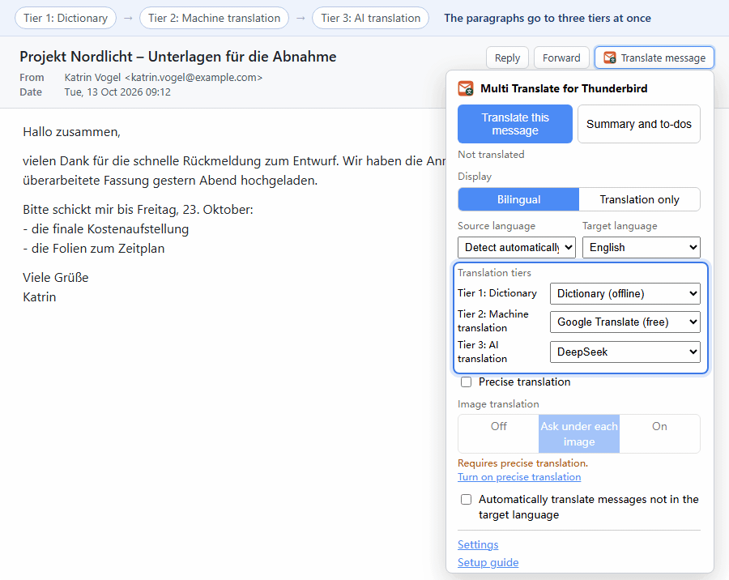

# Çoklu Çeviri for Thunderbird

Çoklu Çeviri for Thunderbird, okuduğunuz iletinin gövdesini doğrudan ileti bölmesinde çeviren bir Thunderbird eklentisidir. Kurulumdan hemen sonra ücretsiz Google Translate ile çalışır. Sürüm 1.13'e kadar adı Thunderbird Translate idi.

[English](../README.md) | [简体中文](README.zh-CN.md) | [繁體中文](README.zh-TW.md) | [日本語](README.ja.md) | [한국어](README.ko.md) | [Français](README.fr.md) | [Deutsch](README.de.md) | [Español](README.es.md) | [Português (Brasil)](README.pt-BR.md) | [Русский](README.ru.md) | Türkçe | [Tiếng Việt](README.vi.md)

## İçindekiler

- [Özellikler](#özellikler)
- [Kurulum](#kurulum)
- [Hızlı başlangıç](#hızlı-başlangıç)
- [Kullanım](#kullanım)
- [Çeviri kademeleri](#çeviri-kademeleri)
- [Çeviri hizmetleri](#çeviri-hizmetleri)
- [Çeviri istemleri](#çeviri-istemleri)
- [Gizlilik](#gizlilik)
- [Bilinen sınırlamalar](#bilinen-sınırlamalar)
- [Belgeler](#belgeler)
- [Teşekkürler](#teşekkürler)
- [Lisans](#lisans)

## Özellikler

- HTML iletilerdeki paragrafları, liste öğelerini, tablo hücrelerini, başlıkları ve alıntıları; düz metin iletilerde ise boş satırlarla ayrılmış paragrafları çevirir. Kod, sayılar, çıplak bağlantılar ve zaten hedef dilde olan paragraflar atlanır. Konu da çevrilir ve gövdenin üstündeki bir satırda gösterilir ("Konuyu da çevir", varsayılan olarak açık).
- İki görünüm modu: iki dilli (çeviri her özgün paragrafın altında) veya yalnızca çeviri; ikisinde de yapay zekâ çevirilerindeki kalın yazı, listeler ve bağlantılar biçimli görünür. Çeviri kapatıldığında özgün ileti olduğu gibi geri gelir.
- Üç çeviri kademesi aynı anda çalışır: çevrimdışı sözlük, makine çevirisi ve yapay zekâ hizmeti. En hızlı sonuç önce görünür, en yüksek kademenin sonucu gelince onun yerini alır.
- Hesap gerektirmeyen ücretsiz hizmetler: Google Translate (varsayılan) ve Microsoft Translator.
- Sözlük paketleri ve Mozilla'nın Bergamot modelleriyle çevrimdışı çeviri; hiçbir metin bilgisayarınızdan çıkmaz.
- OpenAI, Claude, Gemini, DeepSeek, Qwen, yerel Ollama ve LM Studio ile OpenAI uyumlu her hizmeti içeren 22 yapay zekâ sağlayıcısı ön ayarı.
- Hassas çeviri: yapay zekâ kademesi iletinin tamamını görür, bu yüzden adlar ve terimler tutarlı kalır.
- Bölgesel çeşitler, yazım üslupları ve zor sözcükler için hazır ayarları olan, düzenlenebilir üç istem.
- Hedef dilde olmayan her iletinin isteğe bağlı otomatik çevirisi.
- 12 dilde arayüz ve kurulumdan sonra açılan bir kurulum rehberi.

## Kurulum

1. En son `thunderbird-translate-<version>.xpi` dosyasını [Releases sayfasından](https://github.com/willlllliams/thunderbird-translate/releases) indirin.
2. Thunderbird'de Araçlar → Eklentiler ve temalar'ı açın (sağ üst köşedeki ≡ menüsünde de bulunur).
3. Eklenti listesinin üstündeki dişli simgesine tıklayın, "Dosyadan eklenti yükle…" seçeneğini seçin, xpi dosyasını seçip onaylayın.

Thunderbird 128 veya daha yeni bir sürüm gerekir. `nightly` ön sürümü, en son commit'in otomatik derlemesidir ve test amaçlıdır. Deneysel sürüm `multi-translate-experimental-<version>.xpi`, ileti listesine ayrıca "Çevrilmiş konu" sütununu ekler; Thunderbird'ün iç arayüzüne dayanır ve iki sürümden yalnızca biri yüklenebilir ([docs/experimental.md](../docs/experimental.md), İngilizce).

## Hızlı başlangıç

Kurulumdan sonra kurulum rehberi yeni bir sekmede açılır. Her adımda tek bir soru sorar: diller, görünüm modu ve çeviri stili, her kademenin hizmeti (sonucun kısa bir gösterimiyle), çevrimdışı indirmeler, hizmet anahtarları ve istemler. Her seçim hemen kaydedilir ve her adım atlanabilir. Son adım, ayarlarınızla örnek bir ileti çevirir.

Rehberi daha sonra açılır penceredeki "Kurulum rehberi" bağlantısından veya ayarlar sayfasının üstündeki düğmeden yeniden açabilirsiniz. Hiçbir şeyi değiştirmeden bir ileti açıp Alt+A'ya basarsanız ileti Google Translate ile çevrilir.

## Kullanım

Bir ileti açın ve ileti başlığı araç çubuğundaki "İletiyi çevir" düğmesine tıklayın. Açılır pencerede şu denetimler bulunur:

- "Bu iletiyi çevir" çeviriyi başlatır. Çeviri gösterilirken düğmenin adı "Özgün metni göster" olur.
- "Yeniden çevir" her kademeye yeniden sorar ve önbelleği yok sayar.
- Görünüm modu, kaynak dil (varsayılan "Otomatik algıla") ve hedef dil.
- Her kademe için bir hizmet listesi, hassas çeviri ve "Hedef dilde olmayan iletileri otomatik olarak çevir" anahtarı.

| Kısayol | İşlem |
| --- | --- |
| Alt+A | İletiyi çevirir veya özgün metni gösterir |
| Alt+S | İki dilli ile yalnızca çeviri arasında geçiş yapar |
| Alt+R | Önbelleği yok sayarak yeniden çevirir (yalnızca ileti çevrilmişken) |

Kısayollar, Eklenti yöneticisinin dişli menüsündeki "Eklenti kısayollarını yönet" bölümünden değiştirilebilir.

İki dilli modda her çeviri kendi özgün paragrafının altına konur. Yalnızca çeviri modunda çeviri özgün metnin yerini alır; özgün metni görmek için çevirinin üzerine gelin. Ana araç çubuğundaki "Çevrilmiş konular" düğmesi geçerli klasördeki iletileri çevrilmiş konularıyla listeler; bir satıra tıklamak iletiyi gösterir.

Diğer tüm ayarlar, Eklenti yöneticisinde eklentinin "Seçenekler" düğmesiyle açılan ayarlar sayfasındadır. Değişiklikler otomatik kaydedilir; fareyle bir denetimin üzerine gelindiğinde ne işe yaradığı görünür. Her ayar [docs/settings.md](../docs/settings.md) dosyasında (İngilizce) açıklanmıştır.

## Çeviri kademeleri

| Kademe | Hizmetler | Hız | Kalite | Çevrimdışı | Maliyet |
| --- | --- | --- | --- | --- | --- |
| 1 Sözlük | Sözlük | birkaç milisaniye | sözcük sözcük, dilbilgisi yok | evet | ücretsiz; dil çifti başına birkaç MB |
| 2 Makine çevirisi | Google, Microsoft, DeepLX, Bergamot | ileti başına bir ila iki saniye | eksiksiz ve okunaklı | yalnızca Bergamot | ücretsiz; Bergamot yön başına 13–48 MB indirir |
| 3 Yapay zekâ çevirisi | 22 yapay zekâ sağlayıcısı | birkaç saniye ile bir dakika arası | en doğal; istemlerinizi izler | yalnızca yerel modeller | API anahtarınıza kullanım başına faturalanır; yerel modeller ücretsizdir |

Her kademe bir hizmet kullanır veya "Kullanılmıyor" olarak kalır; en az bir kademede hizmet olmalıdır. Varsayılan, 2. kademede Google Translate olması ve başka hiçbir şey olmamasıdır.

Her paragraf, kullanılan tüm kademelere aynı anda gider. Alt kademenin sonucu önce geçici çeviri olarak, italik ve kademesi etiketlenmiş biçimde görünür. Kullanılan en yüksek kademe, geçici çevirinin yerine son çeviriyi koyar; en yüksek kademe başarısız olursa geçici çeviri kalır.

Seçilen bir sözlükte veya Bergamot'ta iletinin dilleri için veri yoksa iletinin üstünde, nelerin indirileceğini söyleyen bir bildirim görünür; bildirimde ayarlara giden bir bağlantı ve "Bu diller için bana tekrar hatırlatma" onay kutusu bulunur.

## Çeviri hizmetleri

| Grup | Hizmetler | Gerekenler |
| --- | --- | --- |
| Ücretsiz | Google Translate | hiçbir şey |
| | Microsoft Translator | hiçbir şey; isteğe bağlı "Kendi anahtarımı kullan (Azure Translator)" modu için Azure anahtarı ve bölge |
| | DeepLX | bir DeepLX sunucusunun uç noktası; belirteç isteğe bağlı |
| Çevrimdışı | Sözlük | Sözlükler bölümünden dil çiftlerini indirin; her biri birkaç MB |
| | Bergamot (Mozilla) | "Çevrimdışı çeviri modelleri (Bergamot)" bölümünden yönleri indirin; her biri 13–48 MB, her modelin bir tarafı İngilizcedir |
| Yapay zekâ | 22 ön ayar | bir API anahtarı; Ollama, LM Studio ve özel OpenAI uyumlu hizmetler için gerekmez |

API anahtarı alma: [OpenAI](https://platform.openai.com/api-keys) · [Anthropic Claude](https://console.anthropic.com/settings/keys) · [Google Gemini](https://aistudio.google.com/apikey) · [DeepSeek](https://platform.deepseek.com/api_keys) · [xAI Grok](https://console.x.ai/) · [Groq](https://console.groq.com/keys) · [Mistral AI](https://console.mistral.ai/api-keys) · [OpenRouter](https://openrouter.ai/keys) · [Together AI](https://api.together.ai/settings/api-keys) · [Fireworks AI](https://fireworks.ai/account/api-keys) · [DeepInfra](https://deepinfra.com/dash/api_keys) · [Cerebras](https://cloud.cerebras.ai/) · [Perplexity](https://www.perplexity.ai/settings/api) · [Moonshot / Kimi](https://platform.moonshot.cn/console/api-keys) · [Zhipu GLM](https://open.bigmodel.cn/usercenter/apikeys) · [DashScope (Qwen)](https://bailian.console.aliyun.com/) · [SiliconFlow](https://cloud.siliconflow.cn/account/ak) · [Volcengine Doubao](https://console.volcengine.com/ark) · [Azure OpenAI](https://learn.microsoft.com/azure/ai-services/openai/). Yerel: [Ollama](https://ollama.com/) · [LM Studio](https://lmstudio.ai/).

Hassas çeviri, her yapay zekâ isteğiyle iletinin tamamını bağlam olarak gönderir ve daha pahalıdır. Her yapay zekâ sağlayıcısının "Düşünme modu" anahtarı varsayılan olarak kapalıdır, çünkü akıl yürütme çeviriyi yavaşlatır ve pahalılaştırır. Uç noktalar, varsayılan modeller, Ollama'nın `OLLAMA_ORIGINS` ayarı ve düşünme parametreleri [docs/providers.md](../docs/providers.md) dosyasında (İngilizce) listelenmiştir.

## Çeviri istemleri

Yapay zekâ kademesi üç istemden birini kullanır: iki dilli görünüm (özgün metne yakın), yalnızca çeviri görünümü (akıcı metin) ve hassas çeviri (ileti boyunca tutarlı terimler). Her biri düzenlenebilir ve "Yerleşik istemi geri yükle" ile eski haline döndürülebilir.

Hazır ayarlar isteme kural ekler: Britanya İngilizcesi veya Tayvan kullanımı gibi bir bölgesel çeşit, bir yazım üslubu, zor sözcüklerin ardından özgün terim ya da zor sözcüklerin kısa açıklamaları. Ayrıntılar [docs/settings.md](../docs/settings.md#prompts) dosyasındadır (İngilizce).

## Gizlilik

- İleti metni yalnızca kullanılan kademelerin hizmetlerine gider. Sözlük ve Bergamot bilgisayarınızda çeviri yapar. İletilerin konuları da aynı kurala uyar.
- Bir iletinin metni bir çevrimiçi hizmete ilk kez gitmeden önce iletinin üstündeki bir panel hizmeti ve adresini gösterir ve her hizmet için bir kez sorar. "İzin ver ve çevir" düğmesine tıklanana kadar hiçbir şey gönderilmez; ayarlar sayfası izin verilen hizmetleri listeler ve izni geri almayı sağlar. Yalnızca sözlük ve Bergamot kullanılırsa hiçbir şey sorulmaz.
- Elle girilen bir adres (Ollama, LM Studio, DeepLX, özel bir hizmet, değiştirilmiş bir adres) bağlantı için bir kez izin ister; izin ayarlarda "Erişime izin ver" veya "Bağlantıyı test et" ile verilir.
- API anahtarları yalnızca Thunderbird profilinizde saklanır ve yalnızca kendi hizmetlerinin uç noktasına gönderilir.
- İki liste, hiçbir ileti metni içermeden ağdan gelir: bu deponun GitHub sürümlerindeki sözlük paketi dizini ve Mozilla'nın Bergamot model kayıtları. Ayarlar sayfası ve kurulum rehberi, çevrimdışı listeleri göstermek için bunları okur. Bir kademede sözlük veya Bergamot seçiliyken Thunderbird başlarken, ayarlar değişirken ve açılır pencere açılırken de okunurlar. Bir iletiyi çevirmek bunları hiçbir zaman okumaz.
- Paketler ve modeller yalnızca bir indirme düğmesine tıkladığınızda indirilir. Eklenti hiçbir istatistik toplamaz.
- Çeviri önbelleği yerel olarak saklanır; kapatılabilir veya temizlenebilir.
- Hassas iletiler için yalnızca sözlüğü, Bergamot'u ve yerel yapay zekâ modellerini (Ollama, LM Studio) kullanın.

## Bilinen sınırlamalar

- Çeviriler düz metindir: özgün metindeki bağlantılar ve satır içi biçimlendirme çeviriye taşınmaz.
- Google ve Microsoft'un ücretsiz uç noktaları belgelenmemiştir; değişebilir veya hız sınırına takılabilir.
- Sözlük, kaynak sözcük sırasında sözcük sözcük karşılık verir.
- Sözlük ve Bergamot, Basitleştirilmiş ile Geleneksel Çince arasında çeviri yapmaz.
- Kullanılan her kademe kendi isteklerini gönderir; bu yüzden yapay zekâ kademesi kullanılırken makine kademesi de ücretsiz hız sınırlarına sayılır.
- Bir hizmetin döndürdüğü hata metinleri, genellikle İngilizce olarak, alındıkları gibi gösterilir.

Tam liste [docs/settings.md](../docs/settings.md#known-limitations) dosyasındadır (İngilizce).

## Belgeler

Aşağıdaki belgeler İngilizcedir; yalnızca dictionary-packs.md Çincedir.

- [docs/settings.md](../docs/settings.md): her ayar, çevrimdışı listeler, eksik veri bildirimleri ve önbellek.
- [docs/providers.md](../docs/providers.md): her hizmetin uç noktaları, varsayılan modelleri ve düşünme parametreleri.
- [docs/batching.md](../docs/batching.md): paragrafların isteklerde nasıl birleştirildiği, zaman aşımları ve maliyetler.
- [docs/bergamot.md](../docs/bergamot.md): çevrimdışı Bergamot motoru, modellerinin seçimi ve saklanması, derlenmesi.
- [docs/dictionary-packs.md](../docs/dictionary-packs.md): sözlük paketlerinin veri kaynakları, biçimi ve derlenmesi (Çince).
- [docs/development.md](../docs/development.md): kaynaktan derleme, testler, proje yapısı, arayüzün çevrilmesi ve sürüm süreci.
- [docs/experimental.md](../docs/experimental.md): "Çevrilmiş konu" sütunlu deneysel sürüm, kurulumu ve riskleri.

## Teşekkürler

- [Read Frog](https://github.com/mengxi-ream/read-frog) (GPL-3.0): paragraf algılama, istek kuyruğu, istemler ve sağlayıcı yapılandırmasının tasarımı.
- [Mozilla Bergamot](https://browser.mt/): çevrimdışı motor ve Firefox Translations modelleri (MPL-2.0).
- [Wiktionary](https://en.wiktionary.org/) (© Wiktionary contributors): İngilizce → Basitleştirilmiş Çince dışındaki sözlük paketleri, [wiktextract](https://github.com/tatuylonen/wiktextract) ile çıkarılıp [kaikki.org](https://kaikki.org/) tarafından yayımlanan Wiktionary verilerinden uyarlanmıştır (çıkarılmış, süzülmüş ve kısaltılmış); lisans CC BY-SA 4.0 (<https://creativecommons.org/licenses/by-sa/4.0/>).
- [ECDICT](https://github.com/skywind3000/ECDICT), Copyright (c) 2025 Linwei, MIT Lisansı: İngilizce → Basitleştirilmiş Çince sözlük paketi ECDICT'ten uyarlanmıştır (çıkarılmış, süzülmüş ve kısaltılmış).

## Lisans

GPL-3.0-or-later. Tam metin için [LICENSE](../LICENSE) dosyasına bakın.
