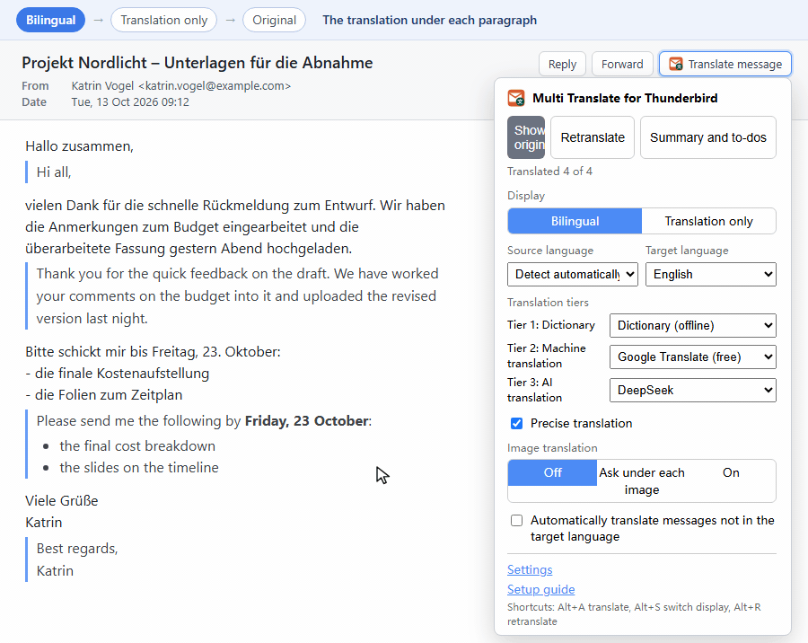
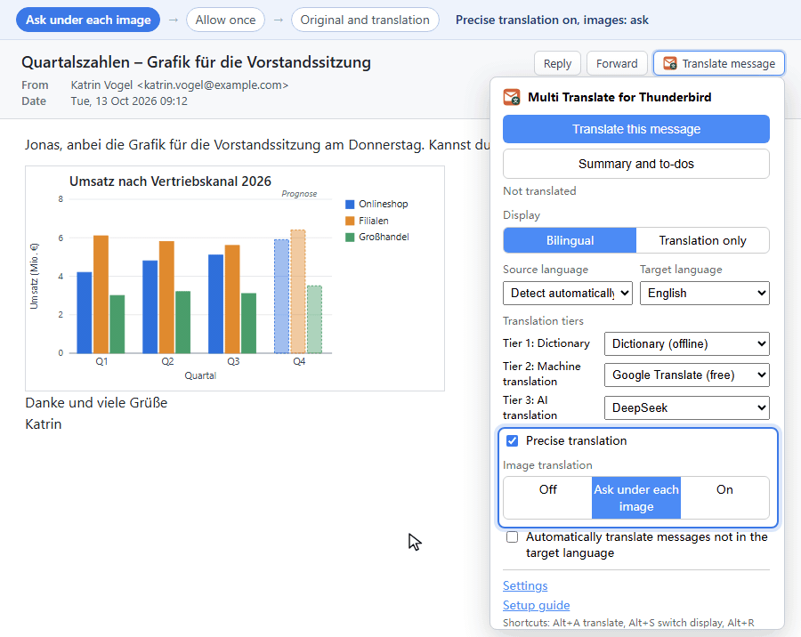
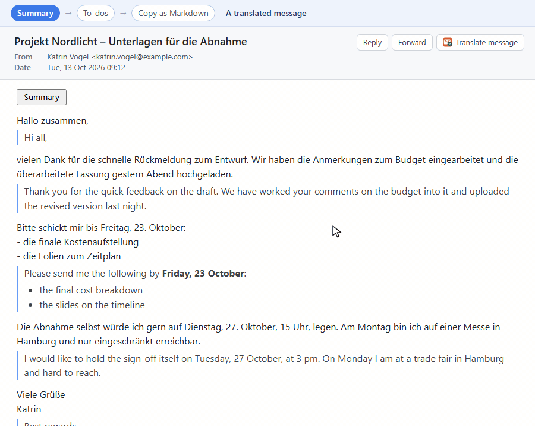

# Dịch Đa Nguồn cho Thunderbird

Dịch Đa Nguồn cho Thunderbird là một tiện ích của Thunderbird, dịch nội dung thư bạn đang đọc ngay trong khung hiển thị thư; cài xong là dùng được với Google Translate miễn phí. Đến phiên bản 1.13, tiện ích có tên Thunderbird Translate.

[English](../README.md) | [简体中文](README.zh-CN.md) | [繁體中文](README.zh-TW.md) | [日本語](README.ja.md) | [한국어](README.ko.md) | [Français](README.fr.md) | [Deutsch](README.de.md) | [Español](README.es.md) | [Português (Brasil)](README.pt-BR.md) | [Русский](README.ru.md) | [Türkçe](README.tr.md) | Tiếng Việt

Video giới thiệu: [YouTube](https://www.youtube.com/watch?v=OZmiMGeuhJ0) (1 phút) · [Bilibili](https://www.bilibili.com/video/BV1JaWw6YENX) (2 phút)

## Mục lục

- [Tính năng](#tính-năng)
- [Cài đặt](#cài-đặt)
- [Bắt đầu nhanh](#bắt-đầu-nhanh)
- [Sử dụng](#sử-dụng)
- [Các tầng dịch](#các-tầng-dịch)
- [Dịch vụ dịch](#dịch-vụ-dịch)
- [Lời nhắc](#lời-nhắc)
- [Quyền riêng tư](#quyền-riêng-tư)
- [Hạn chế đã biết](#hạn-chế-đã-biết)
- [Tài liệu](#tài-liệu)
- [Ghi công](#ghi-công)
- [Giấy phép](#giấy-phép)

## Tính năng

- Dịch đoạn văn, mục danh sách, ô bảng, tiêu đề và khối trích dẫn của thư HTML, cùng các đoạn cách nhau bằng dòng trống của thư văn bản thuần. Mã nguồn, con số, liên kết trơn và các đoạn đã ở ngôn ngữ đích được bỏ qua.
- Hai chế độ hiển thị: song ngữ (bản dịch nằm dưới từng đoạn gốc) hoặc chỉ bản dịch, cả hai đều hiển thị chữ đậm, danh sách và liên kết của bản dịch AI có định dạng. Khi tắt dịch, thư gốc được khôi phục nguyên vẹn.
  
- Ba tầng dịch chạy cùng lúc: từ điển ngoại tuyến, dịch máy và dịch vụ AI. Kết quả nhanh nhất hiện trước, và kết quả của tầng cao nhất thay thế nó.
- Dịch máy không cần tài khoản (Google Translate, mặc định, và Microsoft Translator) hoặc bằng khóa của riêng bạn (DeepL, Baidu, Youdao, Caiyun).
- Dịch ngoại tuyến bằng gói từ điển và các mô hình Bergamot của Mozilla; không có văn bản nào rời khỏi máy của bạn.
- 22 cấu hình sẵn cho nhà cung cấp AI, trong đó có OpenAI, Claude, Gemini, DeepSeek, Qwen, Ollama và LM Studio chạy cục bộ, cùng mọi dịch vụ tương thích OpenAI.
- Dịch chính xác: tầng AI nhận toàn bộ thư làm ngữ cảnh, nên tên riêng và thuật ngữ nhất quán. Khi bật, dịch vụ AI còn đọc được chữ trong ảnh của thư và hiện bản gốc cùng bản dịch dưới mỗi ảnh.
  
- Tóm tắt và việc cần làm: một dịch vụ AI liệt kê phía trên thư bản tóm tắt, các việc cần làm, các câu hỏi cần trả lời và các ngày. Thiết lập "Tự động tóm tắt" mở bản tóm tắt mà không cần bấm, khi dịch thư hoặc cho mọi thư được mở. Với dịch chính xác, thư quá dài cho một yêu cầu cần được phân tích trước khi dịch; khi bản tóm tắt dùng cùng dịch vụ AI và mô hình với tầng AI, một yêu cầu duy nhất viết cả phần phân tích và bản tóm tắt.
  
- Ba lời nhắc có thể chỉnh sửa, kèm mẫu có sẵn cho biến thể vùng miền, văn phong và từ khó.
- Tùy chọn tự động dịch mọi thư không ở ngôn ngữ đích.
- Giao diện có 12 ngôn ngữ và hướng dẫn thiết lập tự mở sau khi cài đặt.

## Cài đặt

1. Tải tệp `thunderbird-translate-<version>.xpi` mới nhất từ [trang Releases](https://github.com/willlllliams/thunderbird-translate/releases).
2. Trong Thunderbird, mở Công cụ → Tiện ích và chủ đề (cũng mở được từ menu ≡ ở góc trên bên phải).
3. Nhấn biểu tượng bánh răng phía trên danh sách tiện ích, chọn "Cài đặt tiện ích từ tập tin…", chọn tệp xpi và xác nhận.

Cần Thunderbird 128 trở lên. Bản tiền phát hành `nightly` là bản dựng tự động của commit mới nhất, dùng để thử nghiệm.

## Bắt đầu nhanh

Sau khi cài đặt, hướng dẫn thiết lập mở trong một thẻ mới. Mỗi bước hỏi một câu: ngôn ngữ, chế độ hiển thị và kiểu bản dịch, dịch vụ của từng tầng (kèm bản minh họa ngắn về kết quả), dữ liệu tải về cho dịch ngoại tuyến, khóa dịch vụ và lời nhắc. Mọi lựa chọn được lưu ngay, và có thể bỏ qua bất kỳ bước nào. Bước cuối dịch một thư mẫu bằng cài đặt hiện tại. Bạn có thể mở lại hướng dẫn từ liên kết "Hướng dẫn thiết lập" trong cửa sổ bật lên hoặc nút ở đầu trang cài đặt. Khi chưa đổi gì, hãy mở một thư và nhấn Alt+A: Google Translate sẽ dịch thư đó.

## Sử dụng

Mở một thư và nhấn nút "Dịch thư" trên thanh công cụ ở phần đầu thư. Cửa sổ bật lên có các điều khiển sau:

- "Dịch thư này" bắt đầu dịch. Khi bản dịch đang hiển thị, nút này đổi thành "Hiện bản gốc".
- "Dịch lại" hỏi lại mọi tầng và bỏ qua bộ nhớ đệm; "Tóm tắt và việc cần làm" hiện bản tóm tắt của thư phía trên thư.
- Chế độ hiển thị, ngôn ngữ nguồn (mặc định là "Tự động phát hiện"), ngôn ngữ đích, danh sách dịch vụ của từng tầng, dịch chính xác cùng chế độ dịch hình ảnh (tắt, hỏi dưới mỗi ảnh, bật; bị làm mờ kèm nút "Bật dịch chính xác" khi dịch chính xác đang tắt), và công tắc "Tự động dịch thư không ở ngôn ngữ đích".

| Phím tắt | Tác dụng |
| --- | --- |
| Alt+A | Dịch thư, hoặc hiện bản gốc |
| Alt+S | Chuyển giữa song ngữ và chỉ bản dịch |
| Alt+R | Dịch lại, bỏ qua bộ nhớ đệm (chỉ khi thư đã được dịch) |

Có thể đổi các phím tắt trong mục "Quản lý phím tắt tiện ích mở rộng" ở menu bánh răng của Trình quản lý tiện ích, nơi bản tóm tắt cũng nhận một phím tắt tùy bạn chọn.

Chế độ song ngữ đặt mỗi bản dịch dưới đoạn gốc của nó. Chế độ chỉ bản dịch thay thế đoạn gốc; di chuột lên bản dịch để xem văn bản gốc.

Mọi cài đặt khác nằm trên trang cài đặt: nút "Tùy chọn" của tiện ích trong Trình quản lý tiện ích. Thay đổi được lưu tự động, và khi rê chuột lên một điều khiển sẽ hiện chú thích về chức năng của nó. Từng cài đặt được mô tả trong [docs/settings.md](../docs/settings.md) (tiếng Anh).

## Các tầng dịch

| Tầng | Dịch vụ | Tốc độ | Chất lượng | Ngoại tuyến | Chi phí |
| --- | --- | --- | --- | --- | --- |
| 1 Từ điển | Từ điển | vài mili giây | từng từ một, không có ngữ pháp | có | miễn phí; vài MB cho mỗi cặp ngôn ngữ |
| 2 Dịch máy | Google, Microsoft, DeepL, Baidu, Youdao, Caiyun, DeepLX, Bergamot | một đến hai giây mỗi thư | đầy đủ và dễ đọc | chỉ Bergamot | miễn phí; DeepL và Baidu có hạn mức miễn phí hằng tháng, Youdao và Caiyun tính phí theo ký tự sau phần dùng thử của tài khoản mới; Bergamot tải 13–48 MB cho mỗi chiều dịch |
| 3 Dịch bằng AI | 22 nhà cung cấp AI | vài giây đến một phút | tự nhiên nhất; theo lời nhắc của bạn | chỉ mô hình cục bộ | tính theo mức dùng trên khóa API của bạn; mô hình cục bộ miễn phí |

Mỗi tầng dùng một dịch vụ hoặc "Không dùng"; ít nhất một tầng cần có dịch vụ. Mặc định là Google Translate ở tầng 2 và không có gì khác.

Mỗi đoạn được gửi cùng lúc đến mọi tầng đang dùng. Kết quả của tầng thấp hơn hiện trước làm bản dịch tạm, in nghiêng và ghi tên tầng. Tầng cao nhất đang dùng thay thế nó bằng bản dịch cuối cùng; nếu tầng cao nhất thất bại, bản dịch tạm được giữ lại.

Khi từ điển hoặc Bergamot đã chọn thiếu dữ liệu cho các ngôn ngữ của thư, một thông báo phía trên thư nêu rõ cần tải gì, kèm liên kết đến trang cài đặt và hộp kiểm "Không nhắc lại với các ngôn ngữ này".

## Dịch vụ dịch

| Nhóm | Dịch vụ | Cần chuẩn bị |
| --- | --- | --- |
| Miễn phí | Google Translate | không cần gì |
| | Microsoft Translator | không cần gì; có chế độ tùy chọn "Dùng khóa của tôi (Azure Translator)" với khóa và khu vực Azure |
| | DeepLX | địa chỉ endpoint của máy chủ DeepLX; token là tùy chọn |
| Với khóa của bạn | DeepL API, Baidu Translate, Youdao, Caiyun | khóa của tài khoản riêng; Baidu và Youdao cần thêm ID ứng dụng |
| Ngoại tuyến | Từ điển | tải các cặp ngôn ngữ trong phần "Từ điển"; vài MB mỗi cặp |
| | Bergamot (Mozilla) | tải các chiều dịch trong "Mô hình dịch ngoại tuyến (Bergamot)"; 13–48 MB mỗi chiều, mọi mô hình đều có tiếng Anh ở một phía |
| AI | 22 cấu hình sẵn | khóa API; Ollama, LM Studio và các dịch vụ tương thích OpenAI tùy chỉnh không cần |

Lấy khóa API: [OpenAI](https://platform.openai.com/api-keys) · [Anthropic Claude](https://console.anthropic.com/settings/keys) · [Google Gemini](https://aistudio.google.com/apikey) · [DeepSeek](https://platform.deepseek.com/api_keys) · [xAI Grok](https://console.x.ai/) · [Groq](https://console.groq.com/keys) · [Mistral AI](https://console.mistral.ai/api-keys) · [OpenRouter](https://openrouter.ai/keys) · [Together AI](https://api.together.ai/settings/api-keys) · [Fireworks AI](https://fireworks.ai/account/api-keys) · [DeepInfra](https://deepinfra.com/dash/api_keys) · [Cerebras](https://cloud.cerebras.ai/) · [Perplexity](https://www.perplexity.ai/settings/api) · [Moonshot / Kimi](https://platform.moonshot.cn/console/api-keys) · [Zhipu GLM](https://open.bigmodel.cn/usercenter/apikeys) · [DashScope (Qwen)](https://bailian.console.aliyun.com/) · [SiliconFlow](https://cloud.siliconflow.cn/account/ak) · [Volcengine Doubao](https://console.volcengine.com/ark) · [Azure OpenAI](https://learn.microsoft.com/azure/ai-services/openai/). Cục bộ: [Ollama](https://ollama.com/) · [LM Studio](https://lmstudio.ai/).

Dịch chính xác gửi toàn bộ thư làm ngữ cảnh trong mọi yêu cầu AI và tốn kém hơn; công tắc "Chế độ suy nghĩ" của từng nhà cung cấp AI mặc định tắt, vì suy luận làm việc dịch chậm và đắt hơn. Endpoint, mô hình mặc định, thiết lập `OLLAMA_ORIGINS` của Ollama và các tham số suy nghĩ được liệt kê trong [docs/providers.md](../docs/providers.md) (tiếng Anh).

## Lời nhắc

Tầng AI dùng một trong ba lời nhắc: hiển thị song ngữ (sát bản gốc), hiển thị chỉ bản dịch (văn xuôi trôi chảy) và dịch chính xác (thuật ngữ nhất quán trong cả thư). Mỗi lời nhắc có thể chỉnh sửa và khôi phục bằng "Khôi phục lời nhắc tích hợp sẵn".

Các mẫu có sẵn thêm quy tắc vào lời nhắc: biến thể vùng miền như tiếng Anh Anh hay cách dùng của Đài Loan, một văn phong, nguyên văn đặt sau từ khó, hoặc lời giải thích ngắn cho từ khó. Chi tiết nằm trong [docs/settings.md](../docs/settings.md#prompt-presets) (tiếng Anh).

## Quyền riêng tư

- Văn bản thư chỉ đến các dịch vụ của những tầng đang dùng. Từ điển và Bergamot dịch ngay trên máy của bạn. Bản tóm tắt, dù mở bằng cú bấm hay tự động, gửi toàn bộ thư cùng người gửi, ngày gửi và tiêu đề đến dịch vụ AI của bản tóm tắt.
- Trước khi nội dung thư lần đầu được gửi đến một dịch vụ trực tuyến, bảng phía trên thư nêu tên dịch vụ và địa chỉ của nó, rồi hỏi một lần cho mỗi dịch vụ và địa chỉ. Không có gì được gửi trước khi bạn bấm "Cho phép và dịch"; trang cài đặt liệt kê các dịch vụ đã cho phép và cho phép thu hồi. Nếu chỉ dùng từ điển và Bergamot thì không có câu hỏi nào.
- Ảnh chỉ được gửi đến dịch vụ AI khi dịch chính xác đang bật: sau khi bạn nhấn nút dưới ảnh, hoặc tự động khi dịch hình ảnh ở chế độ "Bật". Trước ảnh đầu tiên, bảng dưới ảnh hỏi một lần cho mỗi dịch vụ, tách khỏi văn bản. Ảnh được thu nhỏ và mã hóa lại, không kèm tên tệp và siêu dữ liệu. Ảnh từ xa chỉ được tính khi Thunderbird hiển thị nó và bạn đã cho phép đọc ảnh từ xa một lần; tiện ích đọc lại ảnh từ địa chỉ của nó, thường là từ bộ nhớ đệm của Thunderbird.
- Địa chỉ bạn tự nhập (Ollama, LM Studio, DeepLX, dịch vụ tùy chỉnh, địa chỉ đã đổi) cần được cấp quyền kết nối một lần, bằng nút "Cho phép truy cập" hoặc "Kiểm tra kết nối" trong phần cài đặt.
- Khóa API chỉ được lưu trong hồ sơ Thunderbird của bạn và chỉ được gửi đến endpoint của chính dịch vụ đó.
- Hai danh sách lấy từ mạng, không kèm văn bản thư nào: chỉ mục gói từ điển từ các bản phát hành GitHub của kho mã này và các bản ghi mô hình Bergamot từ Mozilla. Trang cài đặt và hướng dẫn thiết lập đọc chúng để hiển thị danh sách ngoại tuyến. Khi từ điển hoặc Bergamot được chọn ở một tầng, chúng cũng được đọc lúc Thunderbird khởi động, khi cài đặt thay đổi và khi mở cửa sổ bật lên. Dịch một thư không bao giờ đọc chúng. Trang cài đặt và hướng dẫn thiết lập cũng gửi câu cố định của "Kiểm tra kết nối" đến Google Translate (miễn phí) và Microsoft Translator (miễn phí), mỗi trang và mỗi dịch vụ một lần, khi hiển thị dịch vụ là đã thêm, để biết mạng này có kết nối được tới dịch vụ hay không.
- Gói và mô hình chỉ được tải khi bạn nhấn nút tải xuống. Bộ nhớ đệm bản dịch được lưu cục bộ và có thể tắt hoặc xóa. Tiện ích không thu thập số liệu thống kê.
- Với thư nhạy cảm, chỉ dùng từ điển, Bergamot và các mô hình AI cục bộ (Ollama, LM Studio).

## Hạn chế đã biết

- Liên kết và định dạng nội dòng của bản gốc không được đưa vào bản dịch. Chữ đậm, danh sách và liên kết chỉ xuất hiện trong bản dịch khi dịch vụ AI viết chúng bằng Markdown; bản dịch của từ điển và của dịch máy, cùng các bản dịch tạm, là văn bản thuần.
- Các endpoint miễn phí của Google và Microsoft không có tài liệu công khai, có thể thay đổi hoặc bị giới hạn tần suất.
- Từ điển chú giải từng từ theo thứ tự từ của bản gốc, và cả từ điển lẫn Bergamot đều không dịch giữa tiếng Trung giản thể và phồn thể.
- Mỗi tầng đang dùng gửi yêu cầu riêng, nên khi dùng tầng AI, tầng dịch máy vẫn tính vào giới hạn tần suất miễn phí.
- Nội dung lỗi do dịch vụ trả về được hiển thị nguyên văn, thường bằng tiếng Anh.

Danh sách đầy đủ nằm trong [docs/settings.md](../docs/settings.md#known-limitations) (tiếng Anh).

## Tài liệu

Các tài liệu dưới đây viết bằng tiếng Anh, riêng dictionary-packs.md viết bằng tiếng Trung.

- [docs/settings.md](../docs/settings.md): mọi cài đặt, danh sách ngoại tuyến, thông báo thiếu dữ liệu và bộ nhớ đệm.
- [docs/providers.md](../docs/providers.md): endpoint, mô hình mặc định, tham số suy nghĩ và các mô hình đọc được ảnh của từng dịch vụ.
- [docs/batching.md](../docs/batching.md): cách gộp đoạn thành yêu cầu, thời gian chờ và chi phí.
- [docs/bergamot.md](../docs/bergamot.md): bộ máy dịch ngoại tuyến Bergamot, cách chọn và lưu mô hình, quy trình build.
- [docs/dictionary-packs.md](../docs/dictionary-packs.md): nguồn dữ liệu, định dạng và cách tạo các gói từ điển (tiếng Trung).
- [docs/development.md](../docs/development.md): build từ mã nguồn, kiểm thử, cấu trúc dự án, dịch giao diện và quy trình phát hành.

## Ghi công

- [Read Frog](https://github.com/mengxi-ream/read-frog) (GPL-3.0): thiết kế việc nhận diện đoạn, hàng đợi gộp lô, lời nhắc và cấu hình nhà cung cấp.
- [Mozilla Bergamot](https://browser.mt/): engine dịch ngoại tuyến và các mô hình Firefox Translations (MPL-2.0).
- [Wiktionary](https://en.wiktionary.org/) (© Wiktionary contributors): các gói từ điển, trừ Anh → Trung giản thể, được phỏng theo (trích xuất, lọc và cắt gọn) Wiktionary do [wiktextract](https://github.com/tatuylonen/wiktextract) trích xuất và [kaikki.org](https://kaikki.org/) phát hành; giấy phép CC BY-SA 4.0 (<https://creativecommons.org/licenses/by-sa/4.0/>).
- [ECDICT](https://github.com/skywind3000/ECDICT), Copyright (c) 2025 Linwei, Giấy phép MIT: gói từ điển Anh → Trung giản thể được phỏng theo (trích xuất, lọc và cắt gọn) ECDICT.

## Giấy phép

GPL-3.0-or-later. Xem toàn văn tại [LICENSE](../LICENSE).
