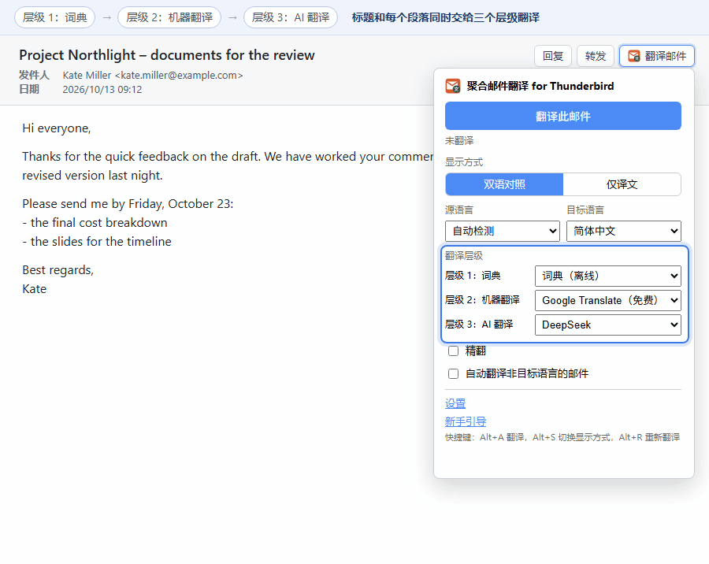
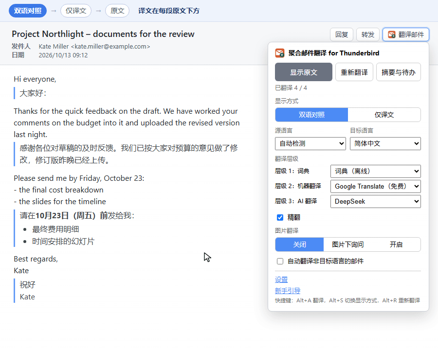
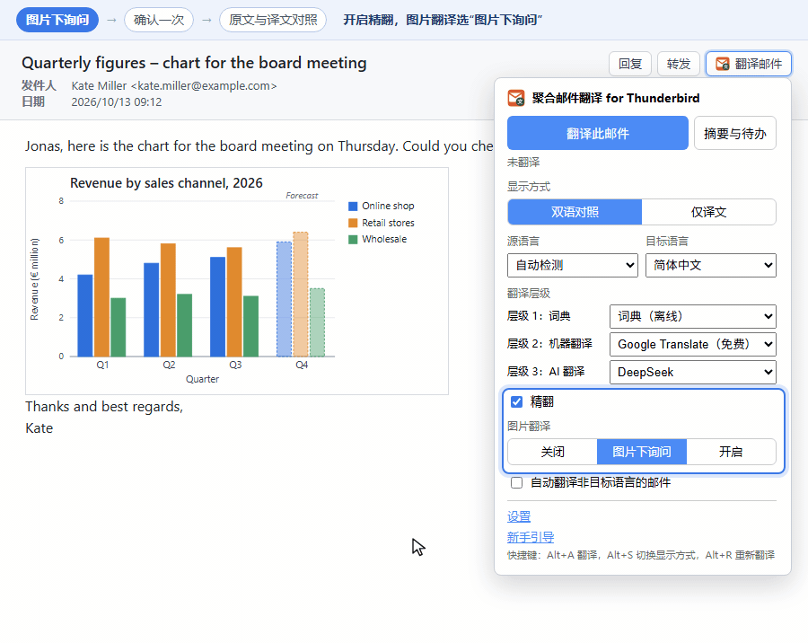
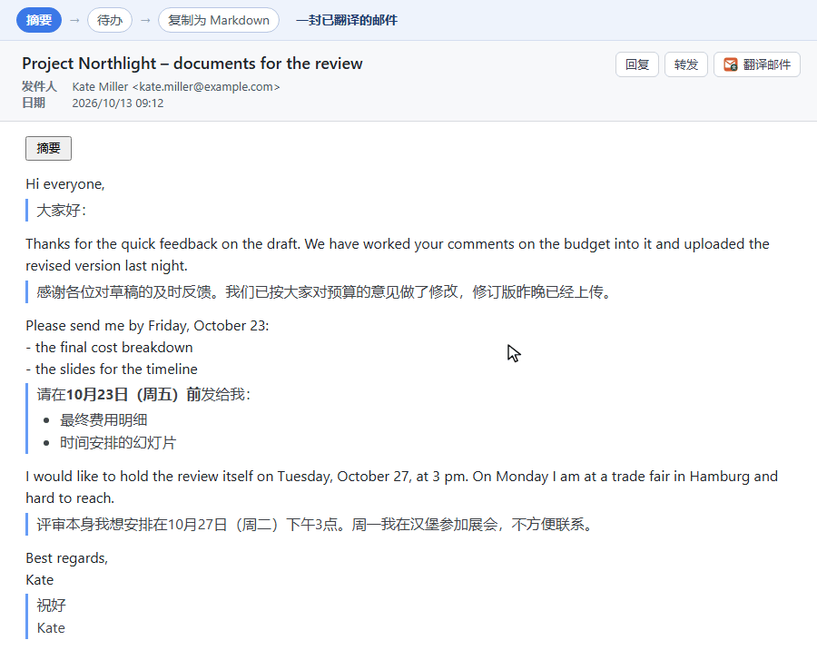

# 聚合邮件翻译 for Thunderbird

聚合邮件翻译 for Thunderbird（Multi Translate for Thunderbird）是一个 Thunderbird 扩展，在阅读窗格里直接翻译正在阅读的邮件正文，装好后用免费的谷歌翻译即可工作。1.13 及以前的版本名为 Thunderbird 邮件翻译（Thunderbird Translate）。

[English](../README.md) | 简体中文 | [繁體中文](README.zh-TW.md) | [日本語](README.ja.md) | [한국어](README.ko.md) | [Français](README.fr.md) | [Deutsch](README.de.md) | [Español](README.es.md) | [Português (Brasil)](README.pt-BR.md) | [Русский](README.ru.md) | [Türkçe](README.tr.md) | [Tiếng Việt](README.vi.md)

视频介绍：[哔哩哔哩](https://www.bilibili.com/video/BV1JaWw6YENX)（2 分钟）· [YouTube](https://www.youtube.com/watch?v=OZmiMGeuhJ0)（1 分钟）

## 目录

- [功能](#功能)
- [安装](#安装)
- [快速开始](#快速开始)
- [使用](#使用)
- [三层翻译](#三层翻译)
- [翻译服务](#翻译服务)
- [提示词](#提示词)
- [隐私](#隐私)
- [已知限制](#已知限制)
- [文档](#文档)
- [致谢](#致谢)
- [许可证](#许可证)

## 功能

- 翻译 HTML 邮件中的段落、列表项、表格单元格、标题和引用，以及纯文本邮件中以空行分隔的段落。代码、纯数字、纯链接和已是目标语言的段落会被跳过。
- 两种显示方式：双语对照（译文放在每段原文下方）和仅译文，两种方式下 AI 译文的粗体、列表和链接都按格式显示。取消翻译后，邮件恢复成原样。
  
- 三个翻译层级同时工作：离线词典、机器翻译和 AI 服务。最快的结果先显示，最高层级的结果到达后替换它。
- 机器翻译：无需注册的谷歌翻译（默认）和微软翻译，以及使用自己密钥的 DeepL、百度翻译、有道智云和彩云小译。
- 离线翻译使用词典包和 Mozilla 的 Bergamot 模型，文字不离开本机。
- 22 个 AI 服务商预设，包括 OpenAI、Claude、Gemini、DeepSeek、通义千问、本地的 Ollama 和 LM Studio，以及任意 OpenAI 兼容服务。
- 精翻：AI 层级以整封邮件为上下文，人名和术语在全文保持一致。开启精翻后，AI 服务还能读取邮件图片里的文字，在每张图片下方显示原文与译文。
  
- 摘要与待办：AI 服务在邮件上方列出摘要、待办事项、需要回复的问题和日期。“自动摘要”设置可在翻译邮件时或对每封打开的邮件自动打开摘要，无需点击。精翻时，一次请求放不下的长邮件需要先做分析再翻译；摘要与 AI 层级使用同一个 AI 服务和模型时，一次请求同时写出分析和摘要。
  
- 三套可编辑的提示词，附带地区用语、语言风格和难词处理的预设。
- 可选自动翻译：打开非目标语言的邮件时自动开始翻译。
- 界面支持 12 种语言，安装后自动打开新手引导。

## 安装

1. 在 [Releases 页面](https://github.com/willlllliams/thunderbird-translate/releases)下载最新的 `thunderbird-translate-<版本号>.xpi`。
2. 在 Thunderbird 中打开“工具 → 附加组件和主题”（右上角 ≡ 菜单里也有）。
3. 点击扩展列表上方的齿轮图标，选择“从文件安装附加组件”，选中 xpi 文件并确认。

扩展要求 Thunderbird 128 或更新版本。预发布版 `nightly` 是最新提交的自动构建，供测试使用。

## 快速开始

安装完成后，新手引导在新标签页中打开。每一步只问一个问题，依次是语言、显示方式与译文样式、各层级的服务（附效果演示）、离线下载、服务密钥和提示词。每个选择立即保存，任何一步都可以跳过。最后一步用当前设置翻译一封示例邮件。之后可以从弹出面板的“新手引导”链接或设置页顶部的按钮再次打开引导。不做任何设置时，打开一封邮件按 Alt+A，谷歌翻译就会翻译它。

## 使用

打开一封邮件，点击邮件头部工具栏上的“翻译邮件”按钮。弹出面板包含以下控件：

- “翻译此邮件”开始翻译。译文显示期间，按钮变为“显示原文”。
- “重新翻译”让每个层级重新翻译，不使用缓存；“摘要与待办”在邮件上方显示这封邮件的摘要。
- 显示方式、源语言（默认“自动检测”）、目标语言、每个层级的服务下拉框、精翻开关及图片翻译方式（关闭、图片下询问、开启；精翻关闭时显示为灰色，并附“开启精翻”按钮），以及“自动翻译非目标语言的邮件”开关。

| 快捷键 | 作用 |
| --- | --- |
| Alt+A | 翻译邮件，或显示原文 |
| Alt+S | 在双语对照和仅译文之间切换 |
| Alt+R | 忽略缓存重新翻译（仅在邮件已翻译时有效） |

快捷键可以在附加组件管理器齿轮菜单的“管理扩展快捷键”中修改，摘要也可以在那里设置自己的快捷键。

双语对照把译文放在对应原文段落的下方。仅译文用译文替换原文，鼠标悬停在译文上可以查看原文。

其余设置都在设置页：在附加组件管理器中点击本扩展的“选项”打开。改动自动保存，鼠标悬停在任一控件上即可看到说明。全部设置项的说明见 [docs/settings.md](../docs/settings.md)（英文）。

## 三层翻译

| 层级 | 可选服务 | 速度 | 质量 | 离线 | 费用 |
| --- | --- | --- | --- | --- | --- |
| 1 词典 | 词典 | 几毫秒 | 逐词对照，没有语法 | 是 | 免费；每个语言对几 MB |
| 2 机器翻译 | 谷歌、微软、DeepL、百度、有道、彩云、DeepLX、Bergamot | 每封邮件一到两秒 | 完整通顺 | 仅 Bergamot | 免费；DeepL 和百度有每月免费额度，有道和彩云在新账号的试用额度用完后按字符计费；Bergamot 每个方向下载 13–48 MB |
| 3 AI 翻译 | 22 个 AI 服务商 | 几秒到一分钟 | 最自然，遵循提示词 | 仅本地模型 | 按用量计入你的 API 密钥；本地模型免费 |

每个层级选一个服务或“不使用”，至少一个层级要有服务。默认只有层级 2 使用谷歌翻译。

每个段落同时发给所有在用的层级。低层级的结果先作为临时译文显示，用斜体并标出层级名称。最高层级的结果到达后替换它，成为最终译文；最高层级失败时，临时译文保留。

选中的词典或 Bergamot 缺少邮件语言所需的数据时，邮件上方出现提醒，写明要下载的内容，附有前往设置页的链接和“这些语言不再提醒我”复选框。

## 翻译服务

| 类别 | 服务 | 需要准备 |
| --- | --- | --- |
| 免费 | 谷歌翻译 | 无 |
| | 微软翻译 | 无；可选“使用我的密钥（Azure Translator）”模式，填写 Azure 密钥和区域 |
| | DeepLX | DeepLX 服务器的接口地址；令牌可选 |
| 自有密钥 | DeepL API、百度翻译、有道智云、彩云小译 | 自己账户的密钥；百度和有道还需要应用 ID |
| 离线 | 词典 | 在“词典”部分下载语言对，每个几 MB |
| | Bergamot（Mozilla） | 在“离线翻译模型（Bergamot）”部分下载方向，每个 13–48 MB，每个模型都有一侧是英语 |
| AI | 22 个预设 | API 密钥；Ollama、LM Studio 和自定义 OpenAI 兼容服务不需要 |

获取 API 密钥：[OpenAI](https://platform.openai.com/api-keys) · [Anthropic Claude](https://console.anthropic.com/settings/keys) · [Google Gemini](https://aistudio.google.com/apikey) · [DeepSeek](https://platform.deepseek.com/api_keys) · [xAI Grok](https://console.x.ai/) · [Groq](https://console.groq.com/keys) · [Mistral AI](https://console.mistral.ai/api-keys) · [OpenRouter](https://openrouter.ai/keys) · [Together AI](https://api.together.ai/settings/api-keys) · [Fireworks AI](https://fireworks.ai/account/api-keys) · [DeepInfra](https://deepinfra.com/dash/api_keys) · [Cerebras](https://cloud.cerebras.ai/) · [Perplexity](https://www.perplexity.ai/settings/api) · [Moonshot / Kimi](https://platform.moonshot.cn/console/api-keys) · [智谱 GLM](https://open.bigmodel.cn/usercenter/apikeys) · [通义千问（阿里云百炼）](https://bailian.console.aliyun.com/) · [硅基流动](https://cloud.siliconflow.cn/account/ak) · [火山引擎豆包](https://console.volcengine.com/ark) · [Azure OpenAI](https://learn.microsoft.com/azure/ai-services/openai/)。本地模型：[Ollama](https://ollama.com/) · [LM Studio](https://lmstudio.ai/)。

精翻在每次 AI 请求中附上整封邮件作为上下文，费用更高；每个 AI 服务商的“思考模式”开关默认关闭，因为推理会让翻译更慢、更贵。各服务的接口地址、默认模型、Ollama 的 `OLLAMA_ORIGINS` 设置和思考参数见 [docs/providers.md](../docs/providers.md)（英文）。

## 提示词

AI 层级使用三套提示词之一：双语对照（贴近原文）、仅译文（行文流畅）和精翻（全文术语一致）。每套都可以编辑，并可用“恢复内置提示词”还原。

预设向提示词追加规则，包括地区用语（如英式英语、台湾用语）、语言风格、在难词后保留原文，以及简短解释难词。详见 [docs/settings.md](../docs/settings.md#prompt-presets)（英文）。

## 隐私

- 邮件文字只发给在用层级的服务。词典和 Bergamot 在本机翻译。 摘要无论点击打开还是自动打开，都会把整封邮件连同发件人、日期和标题发给摘要所用的 AI 服务。
- 邮件文字第一次发送给某个在线服务之前，邮件上方的面板会写明服务名称和地址，每个服务及其地址询问一次。点击“允许并翻译”之前不发送任何内容；设置页列出已允许的服务，也可以撤销。只使用词典和 Bergamot 时不会询问。
- 图片只在精翻开启时发给 AI 服务：点击图片下方的按钮之后，或在图片翻译为“开启”时自动发送。第一张图片发送前，图片下方的面板按服务询问一次，与文字的确认分开。图片缩小并重新编码后发送，不含文件名和元数据。远程图片只在 Thunderbird 已经显示它、且你允许过一次读取远程图片时参与翻译；扩展按图片地址重新读取，通常由 Thunderbird 的缓存直接给出。
- 你填写的接口地址（Ollama、LM Studio、DeepLX、自定义服务、改过的地址）需要授权一次才能连接，在设置中点击“授权访问”或“测试连接”即可。
- API 密钥只保存在你的 Thunderbird 配置文件中，只随请求发给对应服务的接口地址。
- 有两份列表来自网络，不含任何邮件文字：本仓库 GitHub Releases 上的词典包索引，以及 Mozilla 的 Bergamot 模型记录。设置页和新手引导读取它们来显示离线列表。层级中选用了词典或 Bergamot 时，Thunderbird 启动、设置改变和打开弹出面板时也会读取。翻译邮件时从不读取。设置页和新手引导把谷歌翻译（免费）或微软翻译（免费）显示为已添加的服务时，还会向它发送一次“测试连接”的固定句子，每页每个服务一次，用来判断当前网络能否连上。
- 词典包和模型只在你点击下载按钮时下载。翻译缓存保存在本地，可以关闭或清空。扩展不收集任何统计数据。
- 处理敏感邮件时，只使用词典、Bergamot 和本地 AI 模型（Ollama、LM Studio）。

## 已知限制

- 原文中的链接和行内格式不会带到译文里。粗体、列表和链接只在 AI 服务以 Markdown 写出时才出现在译文中；词典、机器翻译的译文和临时译文是纯文本。
- 谷歌和微软的免费接口没有公开文档，可能变更或被限流。
- 词典给出的是按原文词序排列的逐词释义；词典和 Bergamot 都不能在简体中文和繁体中文之间翻译。
- 每个在用的层级各自发送请求，因此同时使用 AI 层级时，机器翻译层级的请求同样计入免费接口的频率限制。
- 翻译服务返回的错误文字按原样显示，通常是英文。

完整列表见 [docs/settings.md](../docs/settings.md#known-limitations)（英文）。

## 文档

以下文档为英文，只有 dictionary-packs.md 为中文。

- [docs/settings.md](../docs/settings.md)：全部设置项、离线列表、缺少离线数据的提醒和缓存。
- [docs/providers.md](../docs/providers.md)：各服务的接口地址、默认模型、思考参数和能读图的模型。
- [docs/batching.md](../docs/batching.md)：段落如何合并成请求、超时和费用。
- [docs/bergamot.md](../docs/bergamot.md)：离线引擎 Bergamot、模型的选择与存储、构建。
- [docs/dictionary-packs.md](../docs/dictionary-packs.md)：词典包的数据来源、格式和构建。
- [docs/development.md](../docs/development.md)：从源码构建、测试、项目结构、翻译界面文字和发布流程。

## 致谢

- [Read Frog](https://github.com/mengxi-ream/read-frog)（GPL-3.0）：段落识别、批处理队列、提示词和服务商配置的设计。
- [Mozilla Bergamot](https://browser.mt/)：离线翻译引擎和 Firefox Translations 模型（MPL-2.0）。
- [Wiktionary](https://en.wiktionary.org/)（© Wiktionary contributors）：除英语 → 简体中文外的词典包改编（抽取、过滤、裁剪）自 Wiktionary，数据由 [wiktextract](https://github.com/tatuylonen/wiktextract) 抽取、[kaikki.org](https://kaikki.org/) 发布，许可证为 CC BY-SA 4.0（<https://creativecommons.org/licenses/by-sa/4.0/>）。
- [ECDICT](https://github.com/skywind3000/ECDICT)，Copyright (c) 2025 Linwei，MIT 许可证：英语 → 简体中文词典包改编（抽取、过滤、裁剪）自 ECDICT。

## 许可证

GPL-3.0-or-later，全文见 [LICENSE](../LICENSE)。
